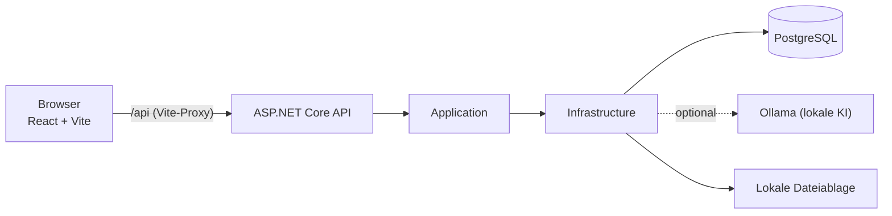

<div align="center">


# JobPilot AI

Bewerbungsmanager mit Dashboard, Kanban-Board und optionaler lokaler KI-Unterstützung.

</div>


## Inhalt

- [Überblick](#überblick)
- [Funktionen](#funktionen)
- [Architektur](#architektur)
- [Schnellstart](#schnellstart)
- [Täglicher Start](#täglicher-start)
- [Konfiguration](#konfiguration)
- [Lokale KI mit Ollama](#lokale-ki-mit-ollama)
- [Tests](#tests)
- [Fehlerbehebung](#fehlerbehebung)
- [Sicherheit](#sicherheit)
- [Projektstruktur](#projektstruktur)
- [Weitere Dokumentation](#weitere-dokumentation)
- [Entwicklungsphasen](#entwicklungsphasen)
- [Lizenz](#lizenz)

## Überblick

JobPilot AI ist eine Full-Stack-Webanwendung zur Verwaltung, Analyse und Auswertung von Bewerbungen.
Sie ersetzt Excel-Listen durch ein Dashboard, ein Kanban-Board, eine Detailseite pro Bewerbung und
Statistiken. Lebenslauf-Auslesen und Match-Analyse können optional von einem lokalen Sprachmodell
(Ollama) unterstützt werden; ohne KI arbeitet die Anwendung regelbasiert. Das Projekt richtet sich an
Bewerbende, die ihren Prozess strukturiert verfolgen möchten, und dient zugleich als Portfolio-Projekt
mit einem ASP.NET-Core-10-Backend in Clean Architecture und einem React-19-Frontend.

| Bereich   | Technologien |
|-----------|--------------|
| Backend   | .NET 10, ASP.NET Core Web API, Entity Framework Core 10, ASP.NET Core Identity, Serilog |
| Datenbank | PostgreSQL 17 (Docker) |
| Frontend  | React 19, TypeScript, Vite, Tailwind CSS 4, React Router, TanStack Query, Recharts, Lucide |
| Tests     | xUnit, Playwright |
| Werkzeuge | Visual Studio 2026, Docker Compose, dotnet-ef |

## Funktionen

### Bewerbungen verwalten

Bewerbungen lassen sich anlegen, filtern, durchsuchen und seitenweise durchblättern. Die Detailseite
bündelt pro Bewerbung Eckdaten, eine Zeitleiste mit Notizen, den Statusverlauf, Dokumente und
Erinnerungen.

<table>
  <tr>
    <td width="50%"><br><sub>Liste mit Filtern und Suche</sub></td>
    <td width="50%"><br><sub>Detailseite einer Bewerbung</sub></td>
  </tr>
  <tr>
    <td width="50%"><br><sub>Aktivität: Notizen-Zeitleiste, Statusverlauf, Erinnerungen</sub></td>
    <td width="50%"><br><sub>Detailseite im dunklen Modus</sub></td>
  </tr>
</table>

### Pflicht-Einstieg nach der Registrierung

Nach der Registrierung führt JobPilot auf die Willkommensseite (`/willkommen`). Dort wird das Profil
entweder aus einem hochgeladenen Lebenslauf vorausgefüllt oder von Hand ausgefüllt. Pflicht sind eine
Wunschposition und mindestens ein Skill. Bis dahin leitet jede geschützte Seite zur Willkommensseite um;
der Abschluss wird serverseitig beim Speichern des Profils entschieden. Bestehende Konten gelten als
abgeschlossen.


### Kanban-Board

Das Board zeigt die Bewerbungen nach Status in Spalten. Karten lassen sich per Drag and Drop zwischen
den Spalten verschieben oder über den Status auf der Karte ändern. Jede Spalte lädt ihre Einträge
seitenweise nach; die Karten gibt es in einer kompakten und einer detaillierten Ansicht.


### KI-Analyse und Anschreiben

Die Match-Analyse vergleicht Profil und Stellenbeschreibung und liefert Score, passende und fehlende
Skills sowie Empfehlungen. Ein lokales Ollama-Modell ist optional, ohne KI greift eine regelbasierte
Analyse. Der Score wird in jedem Fall regelbasiert berechnet (siehe [Lokale KI mit Ollama](#lokale-ki-mit-ollama)).
Anschreiben werden aus einer Vorlage mit Angaben aus Stelle und Profil erstellt und sind als Entwurf
zum Überarbeiten gedacht.


### Statistiken

Auswertungen zu Bewerbungsquote, Gesprächs- und Zusagequote, durchschnittlicher Antwortzeit,
Bewerbungstrichter, Wochenaktivität, Monatsverlauf und Statusverteilung.


### Darstellung

Die Oberfläche unterstützt die Modi Hell, Dunkel und System sowie die Akzentfarben Blau, Grün und
Lila. Die Auswahl wird im Benutzerkonto gespeichert und gilt damit auch auf anderen Geräten.

<table>
  <tr>
    <td width="50%"><br><sub>Dunkler Modus</sub></td>
    <td width="50%"><br><sub>Einstellungen: Modus und Akzentfarbe</sub></td>
  </tr>
  <tr>
    <td width="50%"><br><sub>Akzentfarbe Lila</sub></td>
    <td width="50%"><br><sub>Akzentfarbe Grün</sub></td>
  </tr>
</table>

### Mobil

Die Oberfläche ist für schmale Bildschirme ausgelegt.

<p align="center">
  
  &nbsp;&nbsp;
  
</p>

### Datenschutz

Alle Daten eines Benutzers lassen sich als JSON exportieren (Auskunft und Datenübertragbarkeit nach
Art. 15 und 20 DSGVO). Das Konto kann endgültig gelöscht werden, einschließlich aller hochgeladenen
Dateien.

## Architektur

Kurzüberblick; Datenmodell, Anfrage-Pipeline, KI-Ablauf und Frontend-Aufbau beschreibt
[docs/ARCHITEKTUR.md](docs/ARCHITEKTUR.md) ausführlich.



| Projekt                     | Aufgabe |
|-----------------------------|---------|
| `src/JobPilot.Domain`         | Entitäten, Enums, Domänenregeln (keine Abhängigkeiten) |
| `src/JobPilot.Application`    | Abstraktionen, Optionen, Anwendungslogik |
| `src/JobPilot.Infrastructure` | EF Core, PostgreSQL, Migrations, Seeding |
| `src/JobPilot.Api`            | Controller, Identity, OpenAPI, Serilog, DI-Komposition |
| `tests/JobPilot.Tests`        | xUnit-Tests |
| `frontend`                    | React + TypeScript + Vite |

Architekturentscheidungen:

* **Clean Architecture light**: `Domain` -> `Application` -> `Infrastructure` -> `Api`.
  Die Abhängigkeiten zeigen ausschließlich nach innen.
* **Kein Repository-Pattern** über EF Core. Der `DbContext` ist bereits Unit of Work und Repository.
* **Mandantentrennung**: Jede nutzerbezogene Entität erbt von `OwnedEntityBase` und besitzt eine
  `UserId`. Die ID stammt immer aus den validierten Claims (`ICurrentUser`), niemals aus dem Request-Body.
* **Cookie-Authentifizierung** statt JWT: Das Frontend ist eine First-Party-SPA. Ein `HttpOnly`-Cookie
  ist dort sicherer, weil es für JavaScript nicht lesbar ist. Unauthentifizierte Anfragen erhalten
  401/403 statt eines Redirects auf eine Login-Seite.
* **KI ist optional**: `Ai:Enabled` (Standard `false`) schaltet externe KI-Anbieter frei. Match-Analyse
  und Anschreiben laufen ohne KI regelbasiert. Das MVP läuft vollständig ohne externen KI-Anbieter.
* **Lebensläufe** können als PDF, DOCX, TXT oder MD hochgeladen werden. Der Upload liefert einen
  Profilvorschlag, der erst nach Prüfung über „Profil speichern“ übernommen wird.

## Schnellstart

### Voraussetzungen

* [.NET SDK 10.0](https://dotnet.microsoft.com/download) (getestet mit 10.0.401)
* [Node.js 20+](https://nodejs.org) (getestet mit 23.3.0)
* [Docker Desktop](https://www.docker.com/products/docker-desktop/) für PostgreSQL
* EF-Core-Werkzeug: `dotnet tool update --global dotnet-ef --version 10.0.*`

### 1. Datenbank starten

```bash
docker compose up -d
```

Startet PostgreSQL 17 auf Port `5432` mit Datenbank, Benutzer und Passwort `jobpilot` /
`jobpilot` / `jobpilot_dev`. Diese Zugangsdaten gelten **ausschließlich** für die lokale Entwicklung.

### 2. Datenbankschema anlegen

```bash
dotnet ef database update --project src/JobPilot.Infrastructure --startup-project src/JobPilot.Api
```

Alternativ genügt der Start der API: sie wendet ausstehende Migrationen automatisch an und legt
die Standardrollen an.

### 3. API starten

```bash
dotnet run --project src/JobPilot.Api
```

| Adresse | Zweck |
|---------|-------|
| `http://localhost:5042/api/health` | Erreichbarkeit der API |
| `http://localhost:5042/api/health/database` | Erreichbarkeit der Datenbank |
| `http://localhost:5042/openapi/v1.json` | OpenAPI-Dokument (nur Development) |

### 4. Frontend starten

```bash
cd frontend
npm install
npm run dev
```

Die Oberfläche läuft auf `http://localhost:5173`. Der Vite-Dev-Proxy leitet alle Anfragen an
`/api` an die ASP.NET Core API weiter. Dadurch teilen sich Frontend und API im Browser dieselbe
Origin, was die Cookie-Authentifizierung ohne SameSite-Sonderregeln ermöglicht.

## Täglicher Start

Nach der einmaligen Einrichtung genügen drei Schritte, jeweils in einem eigenen Terminal:

| Schritt | PowerShell (Windows) | Bash |
|---------|----------------------|------|
| 1. Datenbank | `docker compose up -d` | `docker compose up -d` |
| 2. API | `dotnet run --project src/JobPilot.Api` | `dotnet run --project src/JobPilot.Api` |
| 3. Web-App | `cd frontend; npm run dev` | `cd frontend && npm run dev` |
| 4. KI (optional) | `ollama serve` | `ollama serve` |

Danach ist die Anwendung unter **http://localhost:5173** erreichbar, die API unter
**http://localhost:5042**. Die API wendet ausstehende Migrationen beim Start automatisch an. Läuft Ollama
bereits (z. B. als Hintergrunddienst), meldet `ollama serve`, dass die Adresse belegt ist; das ist in Ordnung.

## Konfiguration

Die Konfiguration erfolgt über `src/JobPilot.Api/appsettings.json`. Werte lassen sich per
Umgebungsvariable überschreiben (`__` trennt die Ebenen).

| Schlüssel | Umgebungsvariable | Standard | Bedeutung |
|-------------|-------------------|----------|-----------|
| `ConnectionStrings:Default` | `ConnectionStrings__Default` | lokale Docker-Datenbank | PostgreSQL-Verbindung |
| `App:CorsOrigins` | `App__CorsOrigins__0` | `http://localhost:5173` | Erlaubte Frontend-Origins |
| `Storage:UploadRoot` | `Storage__UploadRoot` | `uploads` | Ablage für Benutzerdokumente |
| `Storage:MaxFileSizeInBytes` | `Storage__MaxFileSizeInBytes` | `10485760` | Maximale Dateigröße (10 MB) |
| `Storage:MaxDocumentsPerUser` | `Storage__MaxDocumentsPerUser` | `100` | Maximale Anzahl Dokumente pro Benutzer |
| `Ai:Enabled` | `Ai__Enabled` | `false` | Schaltet externe KI-Anbieter frei. Match-Analyse und Anschreiben laufen ohne KI regelbasiert. |
| `Ai:Provider` | `Ai__Provider` | `openai` | KI-Anbieter; umgesetzt ist `ollama` (lokal) |
| `Ai:Model` | `Ai__Model` | `gpt-4o-mini` | Modellname; für Ollama z. B. `qwen2.5:3b` |
| `Ai:BaseUrl` | `Ai__BaseUrl` | `http://localhost:11434` | Adresse des KI-Anbieters |
| `Ai:TimeoutSeconds` | `Ai__TimeoutSeconds` | `120` | Danach greift die regelbasierte Analyse |
| `Ai:ApiKey` | `Ai__ApiKey` | leer | **Nur über User Secrets setzen** |
| `Ai:DailyRequestLimitPerUser` | `Ai__DailyRequestLimitPerUser` | `25` | Kostenbremse pro Benutzer und Tag |
| `RateLimiting:GlobalPermitLimit` | `RateLimiting__GlobalPermitLimit` | `120` | Anfragen pro IP und Minute |
| `RateLimiting:AuthPermitLimit` | `RateLimiting__AuthPermitLimit` | `10` | Anmeldungen/Registrierungen pro IP und Minute |

### Secrets niemals committen

API-Schlüssel gehören ausschließlich in die User Secrets:

```bash
dotnet user-secrets set "Ai:ApiKey" "<ihr-schluessel>" --project src/JobPilot.Api
```

Frontend-Variablen für Vite:

```bash
# frontend/.env.local (optional)
VITE_API_PROXY_TARGET=http://localhost:5042
```

## Lokale KI mit Ollama

Lebenslauf-Auslesen und Match-Analyse können ein lokales Sprachmodell nutzen. Das ist kostenlos,
und Lebensläufe verlassen den eigenen Rechner nicht.

```bash
winget install --id Ollama.Ollama -e
ollama pull qwen2.5:3b
```

In `appsettings.Development.json` ist die lokale KI bereits aktiviert (`Enabled: true`,
`Provider: ollama`, `Model: qwen2.5:3b`, `BaseUrl: http://127.0.0.1:11434`). In Produktion bleibt sie
standardmäßig aus.

* **Score bleibt regelbasiert**: Die KI formuliert Zusammenfassung, Empfehlungen und Lernthemen und
  findet weitere Anforderungen. Der Score wird immer mit derselben nachvollziehbaren Formel berechnet.
* **Abgesichert**: Skills und Anforderungen werden nur übernommen, wenn sie wörtlich im Lebenslauf bzw.
  in der Stellenbeschreibung stehen. Zusammenfassungen, die Abgedecktes als fehlend darstellen, und
  Empfehlungen, fehlende Skills anzugeben, werden verworfen.
* **Bereinigte Empfehlungen**: Empfehlungen und Lernthemen werden von Füllfloskeln und Wortwiederholungen
  befreit, Fast-Duplikate entfallen, je Skill bleiben höchstens zwei Einträge; bei Bedarf wird mit
  regelbasierten Empfehlungen aufgefüllt. Aufzählungen wie „Docker, Kubernetes und Azure“ werden in
  einzelne Skills zerlegt.
* **Automatischer Rückfall**: Ist Ollama nicht erreichbar, zu langsam, liefert ungültiges JSON oder ist das
  Tageslimit erreicht, wird regelbasiert gearbeitet. `GET /api/ai/status` zeigt den aktuellen Zustand.
* **Dauer** (RTX 3050 Ti, 4 GB): CV etwa 10–13 s, Analyse etwa 5 s. Der allererste Aufruf nach dem
  Start lädt das Modell und dauert deutlich länger.

## Tests

### Build, Backend und Frontend

```bash
dotnet build "ITjobPolot AI.slnx"
dotnet test tests/JobPilot.Tests
cd frontend && npm run build
```

### Browser-Tests (Playwright)

Die Tests in `frontend/e2e/` laufen gegen die lokale Umgebung in Chromium – Desktop hell, Desktop dunkel
und Handybreite. Jeder Test legt ein eigenes Konto an und löscht es am Ende wieder.

```bash
# einmalig
cd frontend && npx playwright install chromium

# API mit erhöhten Limits starten (sonst greift der Missbrauchsschutz)
RateLimiting__GlobalPermitLimit=100000 RateLimiting__AuthPermitLimit=1000 \
  dotnet run --project src/JobPilot.Api --urls http://localhost:5042

# Tests (Vite startet bei Bedarf automatisch)
cd frontend && npm run e2e        # alle Projekte
npm run e2e -- --project=mobile   # nur Handybreite
npm run e2e:ui                    # interaktiver Modus
```

In PowerShell werden die Umgebungsvariablen vorher gesetzt:

```powershell
$env:RateLimiting__GlobalPermitLimit = "100000"; $env:RateLimiting__AuthPermitLimit = "1000"
dotnet run --project src/JobPilot.Api
```

`e2e/visual.spec.ts` legt Screenshots der Hauptseiten und einen Barrierefreiheitsbericht (axe) in
`frontend/e2e-artifacts/` ab. Schwere und kritische Befunde lassen den Lauf scheitern.

### Screenshots der Dokumentation

```bash
cd frontend && npm run docs:screenshots
```

Das Skript erzeugt die Bilder in `docs/screenshots/` neu und verwendet dafür fiktive Demodaten. Wie bei
den Browser-Tests muss die API mit erhöhten Rate-Limits laufen (siehe oben).
Läuft bereits eine API mit normalen Limits, kann das Skript auch gegen eine zweite Instanz laufen,
z. B. API auf Port 5043 und Vite auf Port 5174 (`VITE_API_PROXY_TARGET=http://localhost:5043`); dann
`E2E_BASE_URL=http://localhost:5174` und `E2E_API_URL=http://localhost:5043` setzen.

## Fehlerbehebung

| Symptom | Ursache | Lösung |
|---------|---------|--------|
| API startet nicht: *address already in use* (Port 5042) | Eine API-Instanz läuft bereits | Andere Instanz beenden oder diese weiterverwenden |
| Fehler beim Binden an Port 5099 o. ä. | Windows reserviert Portbereiche (`netsh interface ipv4 show excludedportrange protocol=tcp`) | Port außerhalb der Reservierung wählen; die API nutzt standardmäßig 5042 |
| Vite meldet *Port 5173 is in use* | Web-App läuft bereits | Vorhandene Instanz im Browser öffnen |
| *Die Datenbank ist nicht erreichbar* / `/api/health/database` schlägt fehl | Docker Desktop oder der Container läuft nicht | Docker starten, `docker compose up -d`, mit `docker ps` prüfen |
| Browser-Tests scheitern mit **429 Too Many Requests** | Rate-Limits der API greifen | API mit erhöhten `RateLimiting__*`-Werten starten (siehe [Browser-Tests](#browser-tests-playwright)) |
| Playwright: *Executable doesn't exist* | Browser nicht installiert | `npx playwright install chromium` im Ordner `frontend` |
| KI-Assistent zeigt „KI nicht erreichbar – regelbasiert“ | Ollama läuft nicht oder Modell fehlt | `ollama serve` und `ollama pull qwen2.5:3b`; Zustand unter `GET /api/ai/status` |
| Erste KI-Analyse dauert sehr lange | Das Modell wird beim ersten Aufruf geladen | Einmal abwarten; folgende Aufrufe sind deutlich schneller |

## Sicherheit

* ASP.NET Core Identity mit Passwortrichtlinie (mindestens 10 Zeichen) und Kontosperre nach
  fünf Fehlversuchen für 15 Minuten.
* `HttpOnly`-, `Secure`- und `SameSite`-Cookies.
* Serverseitige Autorisierung; alle Abfragen filtern zwingend nach der `UserId` aus den Claims.
* Rate Limiting pro IP: 120 Anfragen pro Minute, für Anmeldung und Registrierung 10 pro Minute
  (über `RateLimiting:*` konfigurierbar).
* Restriktive CORS-Konfiguration auf konfigurierte Origins.
* Zentrale Fehler-Middleware, die keine internen Details nach außen gibt.
* Dateiuploads (PDF, DOCX, TXT, MD, PNG, JPG) mit Größenbegrenzung, Prüfung der Dateisignatur
  gegen die Endung, Dublettenerkennung per SHA-256, Kontingent pro Benutzer und Schutz gegen
  Pfadmanipulation. Der Content-Type wird serverseitig aus der Endung bestimmt.
* Datenexport (JSON) und endgültige Kontolöschung inklusive aller Dateien (DSGVO).

## Projektstruktur

```
/
  src/
    JobPilot.Domain/          Entitäten, Enums, Domänenregeln (keine Abhängigkeiten)
    JobPilot.Application/     Abstraktionen, Optionen, Anwendungslogik
    JobPilot.Infrastructure/  EF Core, PostgreSQL, Migrations, Seeding
    JobPilot.Api/             Controller, Identity, OpenAPI, Serilog, DI-Komposition
  tests/
    JobPilot.Tests/           xUnit-Tests
  frontend/                   React + TypeScript + Vite
    e2e/                      Playwright-Tests und Skript für Dokumentations-Screenshots
  docs/                       Benutzerhandbuch, API-Referenz, Architektur
    screenshots/              Screenshots (erzeugt mit npm run docs:screenshots)
  docker-compose.yml          PostgreSQL 17
```

## Weitere Dokumentation

| Dokument | Inhalt |
|----------|--------|
| [docs/BENUTZERHANDBUCH.md](docs/BENUTZERHANDBUCH.md) | Bedienung der Anwendung Schritt für Schritt, mit Screenshots |
| [docs/API.md](docs/API.md) | Alle Endpunkte, Fehlerformat, Rate-Limits und ein Beispielablauf mit curl |
| [docs/ARCHITEKTUR.md](docs/ARCHITEKTUR.md) | Schichten, Datenmodell, Sicherheit, KI-Ablauf, Frontend und Teststrategie |

## Entwicklungsphasen

| Phase | Inhalt | Status |
|-------|--------|--------|
| 1 | Projektgrundlage, Datenbank, API-Gerüst, Frontend-Gerüst | abgeschlossen |
| 2 | Bewerbungsverwaltung (CRUD, Liste, Formular, Filter, Suche, Paging) | abgeschlossen |
| 3 | Dashboard, Benutzerverwaltung, Kanban-Board, Basisstatistiken | abgeschlossen |
| 4 | KI-Stellenanalyse und KI-Anschreiben | abgeschlossen (regelbasiert, optional lokale KI über Ollama) |
| 5 | Dokumente, Erinnerungen, erweiterte Statistiken, Einstellungen | abgeschlossen |
| 6 | Tests, Security-Review, Performance, Docker, Deployment, Doku | teilweise (Unit- und Browser-Tests, Code-Splitting, Doku; Deployment offen) |

## Lizenz

Veröffentlicht unter der [MIT-Lizenz](LICENSE).
