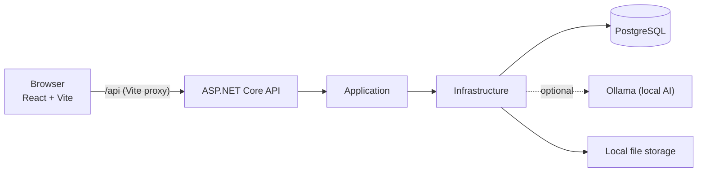

<div align="center">


# JobPilot AI

**A job application manager with a dashboard, Kanban board and optional local AI.**


</div>


## About

Job hunting quickly turns into a mess of spreadsheets, bookmarks and half-remembered follow-ups. JobPilot AI replaces that with one place to track every application: a dashboard, a Kanban board, a detail page per application with notes, documents and reminders, and statistics on how your search is going.

Matching a CV against a job posting and drafting cover letters can optionally be assisted by a local language model (Ollama), so your CV never leaves your machine. Without AI the app falls back to a rule-based analysis.

JobPilot AI is a portfolio project: a full-stack application with an ASP.NET Core 10 backend in Clean Architecture and a React 19 + TypeScript frontend.

## Features

**Application tracking and Kanban board**
- Create, filter, search and page through applications
- Kanban board with one column per status; move cards by drag and drop or via the status on the card, with paged loading per column and compact or detailed cards
- Dashboard and statistics: application rate, interview and offer rates, average response time, funnel, weekly activity, monthly trend and status distribution

**Application details, timeline, reminders and documents**
- Detail page per application with key data, notes timeline and status history
- Reminders per application
- Document uploads (PDF, DOCX, TXT, MD, PNG, JPG) with a per-user quota

**Local AI (optional)**
- Job match analysis: score, matching and missing skills, and recommendations. The score is always computed by a transparent rule-based formula; the AI only adds wording and extra requirements
- Cover letter drafts built from a template with details from the job and your profile
- CV profile extraction from PDF, DOCX, TXT or MD; the result is a suggestion you review before saving
- Automatic fallback to rule-based results when Ollama is unavailable, slow or returns invalid output

**Onboarding**
- After sign-up a welcome page fills your profile from an uploaded CV or lets you enter it by hand; a desired position and at least one skill are required

**Accounts and privacy**
- Registration with mandatory email confirmation, resend option and password reset by email link
- Export all of your data as JSON and permanently delete your account, including all uploaded files

**Themes**
- Light, dark and system mode, plus blue, green and purple accent colors, stored in your account
- Responsive layout for phone-width screens

## Screenshots

<table>
  <tr>
    <td width="50%"><br><sub>Kanban board</sub></td>
    <td width="50%"><br><sub>Application list with filters and search</sub></td>
  </tr>
  <tr>
    <td width="50%"><br><sub>Notes timeline, status history and reminders</sub></td>
    <td width="50%"><br><sub>Job match analysis</sub></td>
  </tr>
  <tr>
    <td width="50%"><br><sub>Statistics</sub></td>
    <td width="50%"><br><sub>Onboarding</sub></td>
  </tr>
  <tr>
    <td width="50%"><br><sub>Dark mode</sub></td>
    <td width="50%"><br><sub>Purple accent color</sub></td>
  </tr>
</table>

<p align="center">
  
  &nbsp;&nbsp;
  
</p>

<p align="center"><sub>The UI is in German. Mobile layout shown above.</sub></p>

## Tech stack

| Area | Technologies |
|------|--------------|
| Backend | .NET 10, ASP.NET Core Web API, Entity Framework Core 10, ASP.NET Core Identity, Serilog |
| Database | PostgreSQL 17 (Docker) |
| Frontend | React 19, TypeScript, Vite, Tailwind CSS 4, React Router, TanStack Query, Recharts, Lucide |
| Email | MailKit (SMTP), Mailpit for development |
| AI | Ollama (local, default model `qwen2.5:3b`), optional |
| Testing | xUnit, Playwright, axe-core, ESLint |
| Tooling | Docker Compose, dotnet-ef |

## Architecture

The backend follows a light Clean Architecture: `Domain` -> `Application` -> `Infrastructure` -> `Api`, with dependencies pointing inward only. There is no repository layer on top of EF Core, because the `DbContext` already is a unit of work and repository. The frontend is a first-party SPA that talks to the API through a Vite proxy, so both share one origin and cookie authentication works without special SameSite rules.



Details on the data model, request pipeline, AI flow and frontend structure are in [docs/ARCHITEKTUR.md](docs/ARCHITEKTUR.md) (German).

## Security and privacy

- **Per-user data isolation**: every user-owned entity carries a `UserId` taken from the validated claims, never from the request body, and all queries filter by it
- **Cookie authentication** with `HttpOnly`, `Secure` and `SameSite` cookies, and security stamp validation
- **Mandatory email confirmation**, enforced on the server: protected endpoints answer `403` until the address is confirmed
- **Lockout and password policy**: at least 10 characters, account lockout for 15 minutes after five failed attempts
- **Rate limiting** per IP, with a stricter limit for sign-in, registration, password reset and email confirmation
- **Password reset without account enumeration**: the forgot-password endpoint always answers `204`, and one-time tokens become invalid when the security stamp changes
- **Safe uploads**: size limit, file signature check against the extension, SHA-256 duplicate detection, per-user quota and path traversal protection
- **Restrictive CORS** and a central error middleware that does not leak internal details
- **No secrets in the repository**: API keys and SMTP credentials go into user secrets or environment variables
- **AI runs locally**: with Ollama, CVs and job postings never leave your machine
- **GDPR-style data rights**: JSON export and permanent account deletion

## Testing

- **Backend**: 170 xUnit tests in `tests/JobPilot.Tests`
- **End-to-end**: Playwright tests in `frontend/e2e/` run in Chromium for desktop light, desktop dark and mobile width. Every test creates and removes its own account and reads confirmation links from real emails via Mailpit
- **Accessibility and visual checks**: `e2e/visual.spec.ts` captures screenshots of the main pages and runs an axe accessibility audit; serious and critical findings fail the run
- **Static analysis**: ESLint with the React Hooks rules (`npm run lint`)

```bash
dotnet test tests/JobPilot.Tests
cd frontend && npm run lint
```

How to run the Playwright suite is described in [docs/SETUP.md](docs/SETUP.md#running-the-tests).

## Getting started

**Prerequisites:** [.NET SDK 10](https://dotnet.microsoft.com/download), [Node.js 20+](https://nodejs.org), [Docker Desktop](https://www.docker.com/products/docker-desktop/), and the EF Core tool (`dotnet tool update --global dotnet-ef --version 10.0.*`).

```bash
# 1. PostgreSQL and Mailpit (test mail server, inbox at http://localhost:8025)
docker compose up -d

# 2. API on http://localhost:5042 (applies database migrations on startup)
dotnet run --project src/JobPilot.Api

# 3. Frontend on http://localhost:5173 (in a second terminal)
cd frontend
npm install
npm run dev
```

Open **http://localhost:5173**, register, and confirm your email in Mailpit.

**Optional local AI:** install [Ollama](https://ollama.com), then run `ollama pull qwen2.5:3b` and `ollama serve`. The Development configuration already points to it.

Configuration keys, the daily start routine, testing and troubleshooting are covered in [docs/SETUP.md](docs/SETUP.md).

## Documentation

| Document | Content |
|----------|---------|
| [docs/SETUP.md](docs/SETUP.md) | Full setup, configuration, local AI, tests and troubleshooting |
| [docs/BENUTZERHANDBUCH.md](docs/BENUTZERHANDBUCH.md) (German) | User guide with screenshots |
| [docs/ARCHITEKTUR.md](docs/ARCHITEKTUR.md) (German) | Layers, data model, security, AI flow, frontend and test strategy |
| [docs/API.md](docs/API.md) (German) | All endpoints, error format, rate limits and an example flow with curl |

## Project structure

```
/
  src/
    JobPilot.Domain/          Entities, enums, domain rules (no dependencies)
    JobPilot.Application/     Abstractions, options, application logic
    JobPilot.Infrastructure/  EF Core, PostgreSQL, migrations, seeding
    JobPilot.Api/             Controllers, Identity, OpenAPI, Serilog, DI composition
  tests/
    JobPilot.Tests/           xUnit tests
  frontend/                   React + TypeScript + Vite
    e2e/                      Playwright tests and documentation screenshot script
  docs/                       Setup guide, user guide, API reference, architecture
    screenshots/              Screenshots (generated with npm run docs:screenshots)
  docker-compose.yml          PostgreSQL 17, Mailpit
```

## License

Released under the [MIT License](LICENSE).
