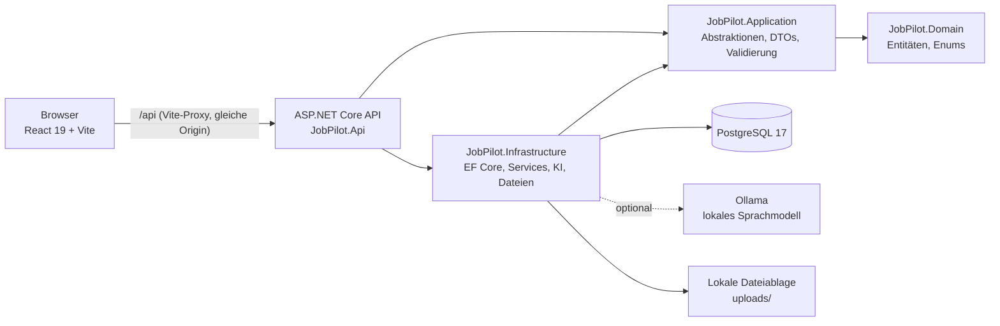
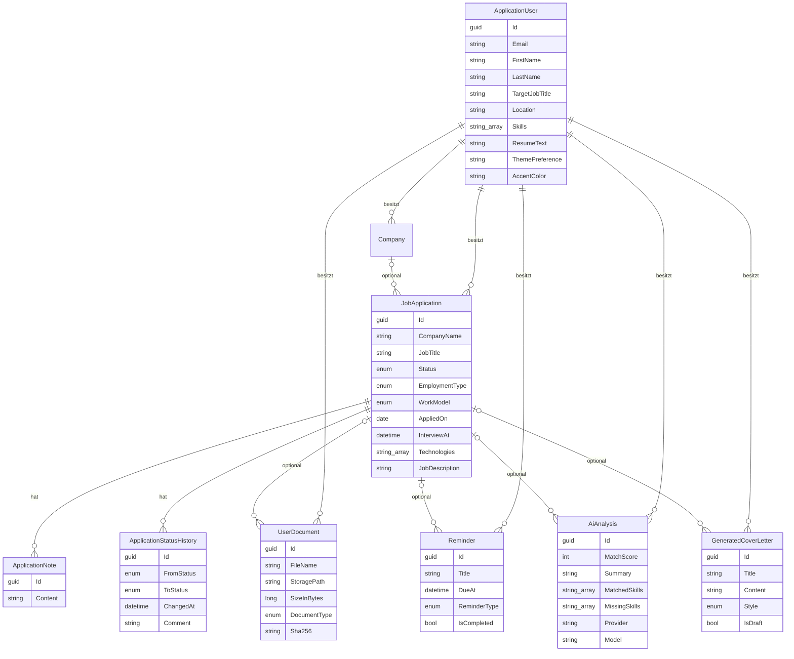
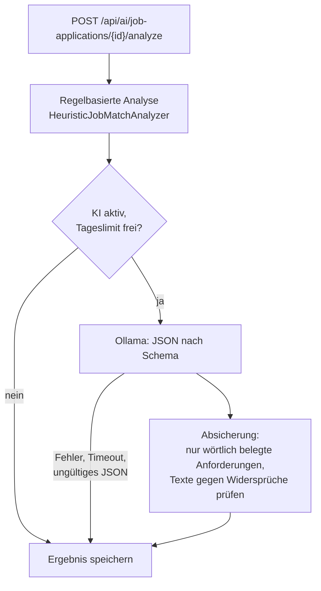

# Architektur

Dieses Dokument beschreibt den technischen Aufbau von JobPilot AI: Schichten, Datenmodell, Sicherheit,
KI-Analyse, Dateiablage, Frontend und Teststrategie. Für Einrichtung und Betrieb siehe die
[README](../README.md), für die Endpunkte die [API-Referenz](API.md).

## Inhalt

- [Überblick](#überblick)
- [Schichten des Backends](#schichten-des-backends)
- [Anfrage-Pipeline](#anfrage-pipeline)
- [Datenmodell](#datenmodell)
- [Authentifizierung und Mandantentrennung](#authentifizierung-und-mandantentrennung)
- [Match-Analyse und KI](#match-analyse-und-ki)
- [Dateien und Uploads](#dateien-und-uploads)
- [Fehlerbehandlung und Logging](#fehlerbehandlung-und-logging)
- [Frontend](#frontend)
- [Teststrategie](#teststrategie)

## Überblick



Frontend und API laufen in der Entwicklung unter derselben Origin: Vite leitet `/api` an die API weiter.
Dadurch funktioniert die Cookie-Anmeldung ohne Sonderregeln für Cross-Site-Cookies.

## Schichten des Backends

| Projekt | Verantwortung | Abhängig von |
|---------|---------------|--------------|
| `JobPilot.Domain` | Entitäten, Enums, Basisklassen (`EntityBase`, `OwnedEntityBase`) | – |
| `JobPilot.Application` | Service-Schnittstellen (`I…Service`), DTOs, FluentValidation-Validatoren, Optionen, Skill-Katalog | Domain |
| `JobPilot.Infrastructure` | `JobPilotDbContext`, Konfigurationen und Migrationen, Service-Implementierungen, Ollama-Client, Dateiablage | Application, Domain |
| `JobPilot.Api` | Controller, Middleware, Filter, Identity- und Cookie-Konfiguration, Komposition (DI) | Application, Infrastructure |

Leitlinien:

* Abhängigkeiten zeigen nach innen; die Domäne kennt weder EF Core noch ASP.NET Core.
* Kein zusätzliches Repository-Pattern: Der `DbContext` ist bereits Unit of Work und Repository.
* Controller sind dünn und delegieren an Services aus `JobPilot.Application.Abstractions`.

## Anfrage-Pipeline

Reihenfolge in `Program.cs`:

1. **Serilog-Request-Logging** (außen, sieht den endgültigen Statuscode)
2. **`ExceptionHandlingMiddleware`** wandelt Ausnahmen in `ProblemDetails` um
3. HSTS und HTTPS-Umleitung (nur außerhalb der Entwicklung)
4. **CORS** für die konfigurierten Origins
5. **Rate Limiting** pro IP (global und strengere Policy `auth`)
6. **Authentifizierung** und **Autorisierung**
7. Controller; davor prüft der `ValidationActionFilter` Modellbindung und FluentValidation

Ungültige Eingaben werden einheitlich als `ValidationFailedException` gemeldet und als
`ValidationProblemDetails` (Status 400, Feldfehler unter `errors`) beantwortet.

## Datenmodell

Alle fachlichen Entitäten erben von `OwnedEntityBase` und tragen damit `Id` (GUID v7), `UserId`,
`CreatedAt` und `UpdatedAt`. Die Zeitstempel pflegt der `DbContext` zentral.



Löschverhalten:

| Beziehung | Verhalten |
|-----------|-----------|
| Benutzer → Bewerbungen, Firmen, Dokumente, Erinnerungen, Analysen, Anschreiben | Kaskadierend gelöscht |
| Bewerbung → Notizen, Statusverlauf | Kaskadierend gelöscht |
| Bewerbung → Erinnerungen, Dokumente, Analysen, Anschreiben | Verweis wird auf `NULL` gesetzt |
| Firma → Bewerbungen | Verweis wird auf `NULL` gesetzt |

Notizen und Statusverlauf verweisen zusätzlich mit `NoAction` auf den Benutzer, um doppelte
Kaskadenpfade zu vermeiden. Die Kontolöschung entfernt sie deshalb ausdrücklich vor dem Benutzer,
in einer Transaktion innerhalb der Execution-Strategy von EF Core. Dateien werden erst nach dem
erfolgreichen Commit gelöscht.

## Authentifizierung und Mandantentrennung

* **ASP.NET Core Identity** mit Cookie-Authentifizierung (`HttpOnly`, `SameSite=Lax`, außerhalb der
  Entwicklung `Secure`). Für eine First-Party-SPA ist ein `HttpOnly`-Cookie sicherer als ein Token im
  JavaScript-Speicher.
* Nicht angemeldete Anfragen erhalten **401** statt einer Umleitung auf eine Login-Seite.
* **Mandantentrennung**: Die Benutzer-ID stammt immer aus den Claims (`ICurrentUser`), nie aus dem
  Request. Jede Abfrage filtert nach `UserId`. Fremde Datensätze werden wie nicht vorhandene behandelt
  und mit **404** beantwortet, damit sich ihre Existenz nicht erraten lässt.
* **Rate Limiting** pro IP: global 120 Anfragen pro Minute, Policy `auth` (Anmeldung, Registrierung,
  Passwortänderung, Export, Kontolöschung) 10 pro Minute. Beide Werte sind über `RateLimiting:*`
  konfigurierbar.

## Match-Analyse und KI



* **Score immer regelbasiert**: Skills 70 %, Erfahrung 15 %, Position 15 % (`HeuristicJobMatchAnalyzer`).
  Die KI ergänzt Zusammenfassung, Empfehlungen, Lernthemen und weitere Anforderungen, verändert die
  Formel aber nicht. Damit bleibt der Score nachvollziehbar und reproduzierbar.
* **Absicherung**: Zusätzliche Anforderungen werden nur übernommen, wenn sie wörtlich in der
  Stellenbeschreibung stehen und fachlich sind; Treffer zählen nur, wenn sie im Profil oder Lebenslauf
  vorkommen.
* **Rückfall**: Ist Ollama nicht erreichbar, zu langsam, liefert ungültiges JSON oder ist das Tageslimit
  (`Ai:DailyRequestLimitPerUser`) erreicht, wird das regelbasierte Ergebnis verwendet.
* Analysen und Anschreiben werden gespeichert und sind über die API wieder abrufbar (letzte Analyse,
  Liste der Anschreiben).

## Dateien und Uploads

* Ablage über `IFileStorage` (lokal: `LocalFileStorage`, Wurzel `Storage:UploadRoot`), Schutz gegen
  Pfadmanipulation.
* Prüfungen beim Upload: erlaubte Endung, **Dateisignatur passend zur Endung**, Größenlimit
  (`Storage:MaxFileSizeInBytes`), Kontingent pro Benutzer (`Storage:MaxDocumentsPerUser`),
  Dublettenerkennung per **SHA-256**. Der Content-Type wird serverseitig aus der Endung bestimmt.
* Profilbilder: PNG oder JPG, höchstens 2 MB, im Browser vorab quadratisch auf 256 × 256 px zugeschnitten.

## Fehlerbehandlung und Logging

| Ausnahme | Status |
|----------|--------|
| `ValidationFailedException`, `ArgumentException` | 400 |
| `UnauthorizedAccessException` | 401 |
| `ForbiddenException` | 403 |
| `NotFoundException`, `KeyNotFoundException` | 404 |
| `ConflictException` | 409 |
| `OperationCanceledException` | 499 |
| alle übrigen | 500 |

* Fachliche Meldungen (404, 403, 409) werden an den Client weitergegeben. Ein Stacktrace erscheint nur
  in der Entwicklung und nur bei Serverfehlern (5xx).
* Serilog protokolliert Anfragen mit Level nach Statuscode: unter 400 *Information*, 4xx *Warning*,
  5xx *Error*. Erwartete Fehler werden ohne Stacktrace geloggt.

## Frontend

```
frontend/src/
  pages/            Seiten (per React.lazy nachgeladen, außer Anmeldung und Dashboard)
  features/         Fachlogik je Bereich: applications, application-detail, dashboard,
                    kanban, settings, auth, documents, reminders
  components/       ui/ (Bausteine), layout/ (Seitenleiste, Layout), brand/ (Logo), charts/
  config/           Navigation
  lib/              API-Client, Formatierung, Hilfsfunktionen
```

* **Datenzugriff** mit TanStack Query; der API-Client (`lib/api.ts`) sendet Cookies mit und übersetzt
  `ProblemDetails` in `ApiError` inklusive Feldfehlern.
* **Kanban-Board**: Jede Spalte lädt seitenweise (15 Karten) per `useInfiniteQuery`. Statuswechsel
  werden optimistisch angezeigt und bei Fehlern zurückgesetzt.
* **Darstellung**: Farben als CSS-Variablen (`index.css`), Modus über die Klasse `dark`, Akzentfarbe über
  `data-accent` am `<html>`-Element. Die Auswahl wird lokal zwischengespeichert und im Konto
  gespeichert; nach der Anmeldung übernimmt `AppearanceSync` den Wert aus dem Konto.
* **Code-Splitting**: Seiten werden bei Bedarf geladen; React und TanStack Query liegen in eigenen
  Chunks, Recharts nur im Chunk der Statistikseite.

## Teststrategie

| Ebene | Werkzeug | Umfang |
|-------|----------|--------|
| Unit- und Service-Tests | xUnit, EF Core InMemory | Validatoren, Services (inkl. Mandantentrennung), Matching, Dateisignaturen |
| API-Tests | `WebApplicationFactory` | Health, 401 ohne Anmeldung, Fehlerformat ohne Interna, konfigurierbares Rate Limiting |
| Browser-Tests | Playwright (Chromium) | Hauptabläufe in Desktop hell, Desktop dunkel und Handybreite |
| Barrierefreiheit | axe-core | Hauptseiten in allen Akzentfarben; schwere und kritische Befunde lassen den Lauf scheitern |

Browser-Tests legen pro Test ein eigenes Konto an und löschen es danach. JavaScript-Fehler im Browser
lassen einen Test scheitern. `npm run docs:screenshots` erzeugt die Bilder dieser Dokumentation mit
fiktiven Beispieldaten.
