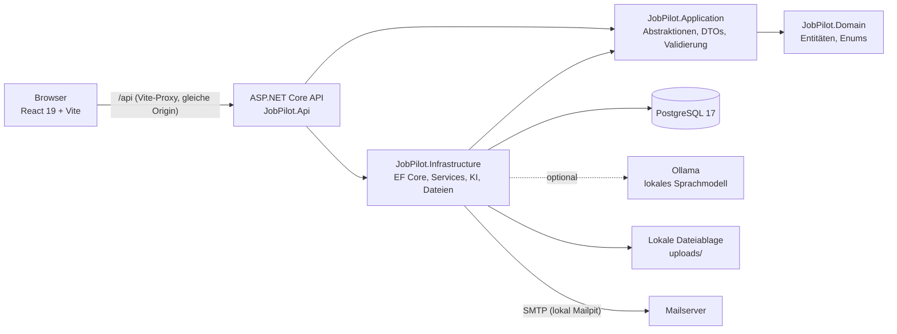
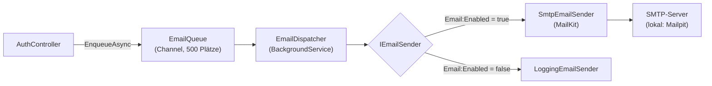
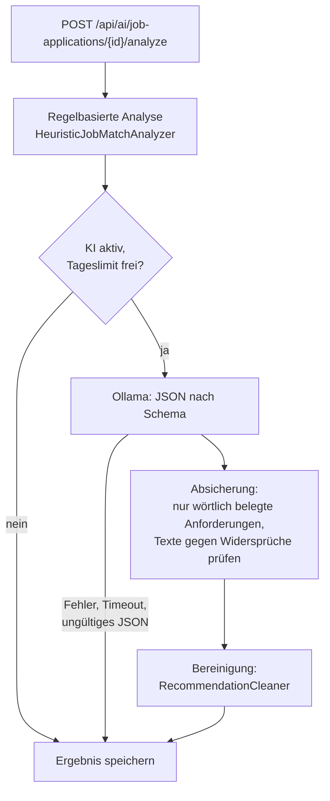

# Architektur

Dieses Dokument beschreibt den technischen Aufbau von JobPilot AI: Schichten, Datenmodell, Sicherheit,
KI-Analyse, E-Mail-Versand, Dateiablage, Frontend und Teststrategie. Für Einrichtung und Betrieb siehe die
[README](../README.md), für die Endpunkte die [API-Referenz](API.md).

## Inhalt

- [Überblick](#überblick)
- [Schichten des Backends](#schichten-des-backends)
- [Anfrage-Pipeline](#anfrage-pipeline)
- [Datenmodell](#datenmodell)
- [Authentifizierung und Mandantentrennung](#authentifizierung-und-mandantentrennung)
- [E-Mail-Versand](#e-mail-versand)
- [Match-Analyse und KI](#match-analyse-und-ki)
- [Dateien und Uploads](#dateien-und-uploads)
- [Fehlerbehandlung und Logging](#fehlerbehandlung-und-logging)
- [Frontend](#frontend)
- [Teststrategie](#teststrategie)

## Überblick



Frontend und API laufen in der Entwicklung unter derselben Origin: Vite leitet `/api` an die API weiter.
Dadurch funktioniert die Cookie-Anmeldung ohne Sonderregeln für Cross-Site-Cookies.

## Schichten des Backends

| Projekt | Verantwortung | Abhängig von |
|---------|---------------|--------------|
| `JobPilot.Domain` | Entitäten, Enums, Basisklassen (`EntityBase`, `OwnedEntityBase`) | – |
| `JobPilot.Application` | Service-Schnittstellen (`I…Service`), DTOs, FluentValidation-Validatoren, Optionen, Skill-Katalog | Domain |
| `JobPilot.Infrastructure` | `JobPilotDbContext`, Konfigurationen und Migrationen, Service-Implementierungen, Ollama-Client, Dateiablage | Application, Domain |
| `JobPilot.Api` | Controller, Middleware, Filter, Identity- und Cookie-Konfiguration, Komposition (DI) | Application, Infrastructure |

Leitlinien:

* Abhängigkeiten zeigen nach innen; die Domäne kennt weder EF Core noch ASP.NET Core.
* Kein zusätzliches Repository-Pattern: Der `DbContext` ist bereits Unit of Work und Repository.
* Controller sind dünn und delegieren an Services aus `JobPilot.Application.Abstractions`.

## Anfrage-Pipeline

Reihenfolge in `Program.cs`:

1. **Serilog-Request-Logging** (außen, sieht den endgültigen Statuscode)
2. **`ExceptionHandlingMiddleware`** wandelt Ausnahmen in `ProblemDetails` um
3. HSTS und HTTPS-Umleitung (nur außerhalb der Entwicklung)
4. **CORS** für die konfigurierten Origins
5. **Rate Limiting** pro IP (global und strengere Policy `auth`)
6. **Authentifizierung** und **Autorisierung**
7. Controller; davor prüft der `ValidationActionFilter` Modellbindung und FluentValidation

Ungültige Eingaben werden einheitlich als `ValidationFailedException` gemeldet und als
`ValidationProblemDetails` (Status 400, Feldfehler unter `errors`) beantwortet.

## Datenmodell

Alle fachlichen Entitäten erben von `OwnedEntityBase` und tragen damit `Id` (GUID v7), `UserId`,
`CreatedAt` und `UpdatedAt`. Die Zeitstempel pflegt der `DbContext` zentral.


Löschverhalten:

| Beziehung | Verhalten |
|-----------|-----------|
| Benutzer → Bewerbungen, Firmen, Dokumente, Erinnerungen, Analysen, Anschreiben | Kaskadierend gelöscht |
| Bewerbung → Notizen, Statusverlauf | Kaskadierend gelöscht |
| Bewerbung → Erinnerungen, Dokumente, Analysen, Anschreiben | Verweis wird auf `NULL` gesetzt |
| Firma → Bewerbungen | Verweis wird auf `NULL` gesetzt |

Notizen und Statusverlauf verweisen zusätzlich mit `NoAction` auf den Benutzer, um doppelte
Kaskadenpfade zu vermeiden. Die Kontolöschung entfernt sie deshalb ausdrücklich vor dem Benutzer,
in einer Transaktion innerhalb der Execution-Strategy von EF Core. Dateien werden erst nach dem
erfolgreichen Commit gelöscht.

## Authentifizierung und Mandantentrennung

* **ASP.NET Core Identity** mit Cookie-Authentifizierung (`HttpOnly`, `SameSite=Lax`, außerhalb der
  Entwicklung `Secure`). Für eine First-Party-SPA ist ein `HttpOnly`-Cookie sicherer als ein Token im
  JavaScript-Speicher.
* Nicht angemeldete Anfragen erhalten **401** statt einer Umleitung auf eine Login-Seite.
* **Mandantentrennung**: Die Benutzer-ID stammt immer aus den Claims (`ICurrentUser`), nie aus dem
  Request. Jede Abfrage filtert nach `UserId`. Fremde Datensätze werden wie nicht vorhandene behandelt
  und mit **404** beantwortet, damit sich ihre Existenz nicht erraten lässt.
* **Pflicht-Einstieg**: `ApplicationUser.OnboardingCompletedAt` hält fest, ob das Profil eingerichtet
  wurde (`null` bei neuen Konten). `PUT /api/auth/profile` ruft `TryCompleteOnboarding` auf: Sind
  Wunschposition und mindestens ein Skill gespeichert, wird der Zeitpunkt gesetzt, und ein einmal
  gesetzter Wert bleibt bestehen. Die Antwort enthält `onboardingCompleted`. Die Migration
  `AddUserOnboarding` markiert bestehende Konten als abgeschlossen.
* **Passwort zurücksetzen**: `POST /api/auth/forgot-password` antwortet immer mit 204, auch für unbekannte
  Adressen. Existiert ein Konto, erzeugt der Server ein Identity-Reset-Token und reiht die E-Mail in die
  Versandwarteschlange ein (siehe [E-Mail-Versand](#e-mail-versand)). Da der Versand im Hintergrund läuft,
  verrät auch die Antwortzeit nicht, ob die Adresse existiert. `POST /api/auth/reset-password` löst das
  Token ein; es gilt 2 Stunden und nur einmal, weil es an den Sicherheitsstempel des Kontos gebunden ist.
  Ungültige, abgelaufene und verbrauchte Tokens führen zur selben 400-Meldung. Nach dem Zurücksetzen gilt
  die Adresse als bestätigt, und eine Kontosperre wird aufgehoben.
* **E-Mail-Bestätigung (Pflicht)**: Die Registrierung reiht eine Bestätigungsmail ein. Die Anmeldung bleibt
  ohne Bestätigung möglich (`RequireConfirmedAccount = false`), damit sich eine neue Mail anfordern lässt;
  danach ist aber fast nichts mehr erreichbar. `JobPilotClaimsPrincipalFactory` schreibt den Status als
  Claim `jobpilot:email_confirmed` in das Cookie. Die Standard-Autorisierungs-Policy
  (`Authorization/EmailConfirmation.cs`) verlangt diesen Claim mit dem Wert `true`; sie gilt für jeden
  `[Authorize]`-Endpunkt ohne weitere Angabe. Nur die Policy `AllowUnconfirmedEmail` (angemeldet genügt)
  ist ausgenommen und steht an `GET /api/auth/me`, `POST /api/auth/logout`,
  `POST /api/auth/resend-confirmation`, `GET /api/auth/export` und `DELETE /api/auth/account`. Öffentliche
  Endpunkte (Registrierung, Anmeldung, Passwort-Reset, `confirm-email`, Health) bleiben unverändert. Wird
  der Zugriff verweigert, antwortet die Cookie-Konfiguration (`OnRedirectToAccessDenied`) mit `403` und
  einem ProblemDetails-Körper („E-Mail-Adresse noch nicht bestätigt.“), statt umzuleiten. Damit der Claim
  nicht veraltet, stellt `GET /api/auth/me` das Cookie neu aus, wenn er vom Datenbankstand abweicht (etwa
  nach einer Bestätigung in einem anderen Browser oder bei Cookies aus der Zeit vor der Pflicht);
  `POST /api/auth/confirm-email` erneuert das Cookie, wenn derselbe Benutzer angemeldet ist. Der Endpunkt
  verlangt keine Sitzung und antwortet auch bei bereits bestätigter Adresse mit 204;
  `POST /api/auth/resend-confirmation` verschickt die Mail erneut. Die Migration
  `MarkExistingEmailsConfirmed` setzt `EmailConfirmed` bei allen bestehenden Konten auf `true`, damit
  sie nicht ausgesperrt werden.
* **Rate Limiting** pro IP: global 120 Anfragen pro Minute, Policy `auth` (Anmeldung, Registrierung,
  Passwortänderung, Export, Kontolöschung sowie Passwort-Zurücksetzen und E-Mail-Bestätigung) 10 pro Minute. Beide Werte sind über `RateLimiting:*`
  konfigurierbar.

## E-Mail-Versand

JobPilot verschickt zwei Arten von E-Mails: die Bestätigung der Adresse nach der Registrierung und den
Link zum Zurücksetzen des Passworts. Die Schnittstellen liegen in `JobPilot.Application.Abstractions`,
die Umsetzung in `JobPilot.Infrastructure/Email`.



* **`IEmailSender`** versendet eine `EmailMessage` (Empfänger, Betreff, HTML- und Textfassung). Welche
  Implementierung gilt, entscheidet `Email:Enabled` bei der Auflösung im DI-Container:
  `SmtpEmailSender` sendet über MailKit (Host, Port, optional STARTTLS und Anmeldung aus `EmailOptions`),
  `LoggingEmailSender` verschickt nichts. In der Entwicklung schreibt er den Textinhalt samt Link ins Log,
  damit sich die Abläufe auch ohne Mailserver testen lassen; sonst schreibt er nur eine Warnung ohne Inhalt,
  weil die Links Tokens enthalten. Der SMTP-Sender protokolliert keine Empfängeradressen.
* **Warteschlange und Dispatcher**: Controller rufen nicht den Sender, sondern `IEmailQueue` auf.
  `EmailQueue` ist ein begrenzter `Channel` im Speicher; der `EmailDispatcher` (ein `BackgroundService`)
  arbeitet ihn nacheinander ab und löst den Sender je Nachricht in einem eigenen Scope auf. Das hat zwei
  Gründe: Anfragen warten nicht auf den Mailserver, und `forgot-password` antwortet für bekannte und
  unbekannte Adressen gleich schnell. Ein Versandfehler wird protokolliert und beendet den Dienst nicht;
  die auslösende Anfrage ist dann schon beantwortet. Die Warteschlange liegt nur im Speicher, nicht
  gesendete Mails gehen bei einem Neustart verloren; der Benutzer kann sie über „Erneut senden“ bzw.
  „Passwort vergessen?“ neu anfordern.
* **Vorlagen** (`AccountEmails`): Betreff, Text- und HTML-Fassung für Bestätigung und Passwort-Reset. Alle
  eingesetzten Werte (Anrede mit dem vom Benutzer eingegebenen Vornamen, Link, Texte) werden für die
  HTML-Fassung HTML-kodiert, sodass keine Eingabe Markup einschleusen kann.
* **Links**: Sie entstehen aus `App:FrontendBaseUrl` und verweisen auf Seiten des Frontends
  (`/passwort-zuruecksetzen`, `/email-bestaetigen`). Das Identity-Token wird als Base64Url kodiert, weil
  das Original `+`, `/` und `=` enthalten kann, und von der API beim Einlösen wieder dekodiert.
* **Token-Anbieter** (`IdentityServiceExtensions`): Reset-Links laufen über den Standard-Anbieter mit
  2 Stunden Gültigkeit. Bestätigungslinks nutzen einen eigenen Anbieter (`EmailConfirmationTokenProvider`)
  mit 3 Tagen, weil ein Zugriff nach der Registrierung nicht sofort erfolgen muss. Beide Token werden mit
  dem Sicherheitsstempel des Kontos ungültig.
* **Entwicklung**: `docker compose up -d` startet neben PostgreSQL auch Mailpit (SMTP `127.0.0.1:1025`,
  Oberfläche `http://localhost:8025`, nur lokal erreichbar). `appsettings.Development.json` aktiviert den
  SMTP-Versand ohne STARTTLS gegen Mailpit; alle Mails landen dort, nichts verlässt den Rechner. In
  `appsettings.json` ist `Email:Enabled` `false`; für den Betrieb müssen Server und Zugangsdaten
  (Letztere nur über User Secrets oder Umgebungsvariablen) konfiguriert werden.

## Match-Analyse und KI



* **Score immer regelbasiert**: Skills 70 %, Erfahrung 15 %, Position 15 % (`HeuristicJobMatchAnalyzer`).
  Die KI ergänzt Zusammenfassung, Empfehlungen, Lernthemen und weitere Anforderungen, verändert die
  Formel aber nicht. Damit bleibt der Score nachvollziehbar und reproduzierbar.
* **Absicherung**: Zusätzliche Anforderungen werden nur übernommen, wenn sie wörtlich in der
  Stellenbeschreibung stehen und fachlich sind; Treffer zählen nur, wenn sie im Profil oder Lebenslauf
  vorkommen.
* **Bereinigung**: `RecommendationCleaner` arbeitet deterministisch und ohne KI auf Empfehlungen und
  Lernthemen. Er entfernt Füllfloskeln am Satzende (z. B. „…, um deine Fähigkeiten zu erweitern“),
  verwirft Sätze mit Wortwiederholungen (z. B. „Azure-Tools und -Tools“) und Fast-Duplikate (nur unter
  Einträgen zu denselben Skills) und lässt höchstens zwei Einträge je Skill zu. Bleiben weniger als zwei
  übrig, werden die regelbasierten Empfehlungen ergänzt; Lernthemen bleiben Stichworte ohne Schlusspunkt.
  Zusätzliche Anforderungen, die das Modell als Aufzählung liefert (z. B. „Docker, Kubernetes und Azure“),
  werden in einzelne Skills zerlegt. `AiService` wendet den Bereiniger auch beim Lesen der zuletzt
  gespeicherten Analyse an, sodass ältere Analysen bereinigt ausgeliefert werden.
* **Rückfall**: Ist Ollama nicht erreichbar, zu langsam, liefert ungültiges JSON oder ist das Tageslimit
  (`Ai:DailyRequestLimitPerUser`) erreicht, wird das regelbasierte Ergebnis verwendet.
* Analysen und Anschreiben werden gespeichert und sind über die API wieder abrufbar (letzte Analyse,
  Liste der Anschreiben).

## Dateien und Uploads

* Ablage über `IFileStorage` (lokal: `LocalFileStorage`, Wurzel `Storage:UploadRoot`), Schutz gegen
  Pfadmanipulation.
* Prüfungen beim Upload: erlaubte Endung, **Dateisignatur passend zur Endung**, Größenlimit
  (`Storage:MaxFileSizeInBytes`), Kontingent pro Benutzer (`Storage:MaxDocumentsPerUser`),
  Dublettenerkennung per **SHA-256**. Der Content-Type wird serverseitig aus der Endung bestimmt.
* Profilbilder: PNG oder JPG, höchstens 2 MB, im Browser vorab quadratisch auf 256 × 256 px zugeschnitten.

## Fehlerbehandlung und Logging

| Ausnahme | Status |
|----------|--------|
| `ValidationFailedException`, `ArgumentException` | 400 |
| `UnauthorizedAccessException` | 401 |
| `ForbiddenException` | 403 |
| `NotFoundException`, `KeyNotFoundException` | 404 |
| `ConflictException` | 409 |
| `OperationCanceledException` | 499 |
| alle übrigen | 500 |

* Fachliche Meldungen (404, 403, 409) werden an den Client weitergegeben. Ein Stacktrace erscheint nur
  in der Entwicklung und nur bei Serverfehlern (5xx).
* Serilog protokolliert Anfragen mit Level nach Statuscode: unter 400 *Information*, 4xx *Warning*,
  5xx *Error*. Erwartete Fehler werden ohne Stacktrace geloggt.

## Frontend

```
frontend/src/
  pages/            Seiten (per React.lazy nachgeladen, außer Anmeldung und Dashboard)
  features/         Fachlogik je Bereich: applications, application-detail, dashboard,
                    kanban, settings, auth, documents, reminders
  components/       ui/ (Bausteine), layout/ (Seitenleiste, Layout), brand/ (Logo), charts/
  config/           Navigation
  lib/              API-Client, Formatierung, Hilfsfunktionen
```

* **Datenzugriff** mit TanStack Query; der API-Client (`lib/api.ts`) sendet Cookies mit und übersetzt
  `ProblemDetails` in `ApiError` inklusive Feldfehlern.
* **Kanban-Board**: Jede Spalte lädt seitenweise (15 Karten) per `useInfiniteQuery`. Statuswechsel
  werden optimistisch angezeigt und bei Fehlern zurückgesetzt.
* **Routenschutz**: `ProtectedRoute` prüft in fester Reihenfolge: 1. Ist `emailConfirmed === false`, führt jede
  geschützte Seite auf `/bestaetigung-ausstehend` (`ConfirmationPendingPage`); ist die Adresse bestätigt,
  führt diese Seite zurück zum Dashboard. Die Seite bietet „Ich habe bestätigt“ (ruft `GET /api/auth/me` ab,
  das bei bestätigter Adresse das Cookie erneuert), „Erneut senden“ (30 Sekunden Wartezeit) und „Abmelden“.
  Die Registrierung navigiert direkt dorthin. 2. Ist der Einstieg offen, geht es auf `/willkommen`. 3. Sonst
  öffnet sich die Anwendung.
* **Pflicht-Einstieg**: `ProtectedRoute` leitet Benutzer mit `onboardingCompleted === false` (nach der
  E-Mail-Bestätigung) von jeder geschützten Seite auf `/willkommen` (`OnboardingPage`) um, auch nach einer erneuten Anmeldung;
  ist der Einstieg abgeschlossen, führt `/willkommen` zurück zum Dashboard. Die Seite bietet nur
  „Abmelden“, keinen Überspringen-Weg. Die Entscheidung trifft der Server beim Speichern des Profils.
* **Darstellung**: Farben als CSS-Variablen (`index.css`), Modus über die Klasse `dark`, Akzentfarbe über
  `data-accent` am `<html>`-Element. Die Auswahl wird lokal zwischengespeichert und im Konto
  gespeichert; nach der Anmeldung übernimmt `AppearanceSync` den Wert aus dem Konto.
* **Anmeldeseiten**: Anmeldung, Registrierung, „Passwort vergessen“, „Neues Passwort festlegen“ und die
  E-Mail-Bestätigung teilen sich `AuthLayout` (Markenfläche links, Formular rechts). `PasswordInput`
  (mit Schalter zum Anzeigen) und `PasswordRules` (Live-Checkliste der Passwortregeln) sind gemeinsame
  Bausteine in `features/auth`; Registrierung und Passwort-Reset verwenden dieselben Regeln. Die Wartseite
  `ConfirmationPendingPage` nutzt ebenfalls `AuthLayout` und ersetzt den früheren Hinweisbalken im `AppLayout`.
* **Code-Splitting**: Seiten werden bei Bedarf geladen; React und TanStack Query liegen in eigenen
  Chunks, Recharts nur im Chunk der Statistikseite.

## Teststrategie

| Ebene | Werkzeug | Umfang |
|-------|----------|--------|
| Unit- und Service-Tests | xUnit, EF Core InMemory | Validatoren, Services (inkl. Mandantentrennung), Matching, Dateisignaturen |
| API-Tests | `WebApplicationFactory` | Health, 401 ohne Anmeldung, Fehlerformat ohne Interna, konfigurierbares Rate Limiting |
| Browser-Tests | Playwright (Chromium) | Hauptabläufe in Desktop hell, Desktop dunkel und Handybreite, einschließlich E-Mail-Bestätigung und Passwort-Reset |
| Barrierefreiheit | axe-core | Hauptseiten in allen Akzentfarben; schwere und kritische Befunde lassen den Lauf scheitern |

Browser-Tests legen pro Test ein eigenes Konto an und löschen es danach. Sie arbeiten mit echten E-Mails: Die Tests lesen die Links aus Mailpit (Fixture `waitForMailLink`, Adresse über `E2E_MAILPIT_URL`, Standard `http://127.0.0.1:8025`) und bestätigen damit auch die Adressen der Testkonten; ohne laufendes Mailpit bricht das Setup ab. Die Unit-Tests (`AccountEmailsTests`) decken Token-Kodierung, Links, HTML-Kodierung, den Dispatcher und die neuen Validatoren ab. JavaScript-Fehler im Browser
lassen einen Test scheitern. `npm run docs:screenshots` erzeugt die Bilder dieser Dokumentation mit
fiktiven Beispieldaten.
