# Benutzerhandbuch

Dieses Handbuch zeigt dir Schritt für Schritt, wie du mit JobPilot AI deine Bewerbungen erfasst, im Blick behältst und mit Analysen und Anschreiben unterstützt wirst.

## Inhaltsverzeichnis

1. [Erste Schritte](#1-erste-schritte)
   - [Passwort vergessen](#passwort-vergessen)
2. [Profil einrichten](#2-profil-einrichten)
3. [Bewerbungen erfassen und verwalten](#3-bewerbungen-erfassen-und-verwalten)
4. [Das Kanban-Board](#4-das-kanban-board)
5. [KI-Analyse und Anschreiben](#5-ki-analyse-und-anschreiben)
6. [Erinnerungen](#6-erinnerungen)
7. [Dokumente](#7-dokumente)
8. [Statistiken](#8-statistiken)
9. [Darstellung anpassen](#9-darstellung-anpassen)
10. [Daten und Datenschutz](#10-daten-und-datenschutz)
11. [Häufige Fragen](#11-häufige-fragen)

---

## 1. Erste Schritte

### Konto anlegen

Öffne JobPilot und wähle auf der Anmeldeseite den Link „Jetzt registrieren“. Es erscheint die Seite „Konto erstellen“.

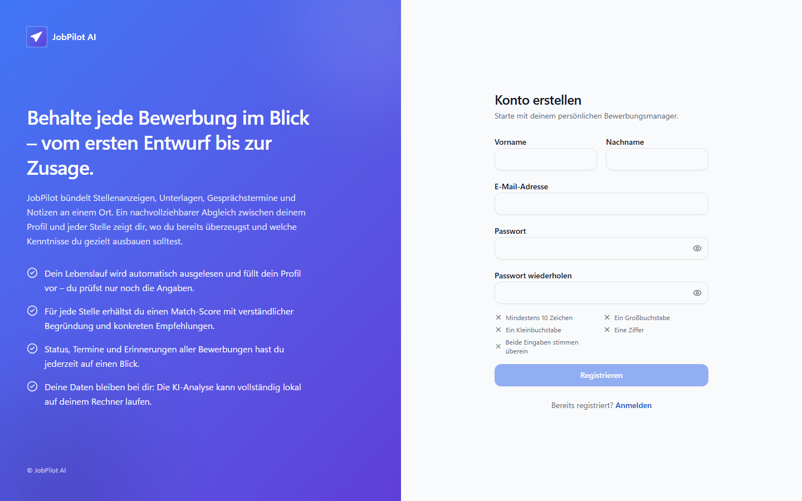

Fülle die Felder aus:

- **Vorname** und **Nachname** (optional)
- **E-Mail-Adresse** (Pflichtfeld). Mit ihr meldest du dich später an. Sie lässt sich nachträglich nicht ändern.
- **Passwort** und **Passwort wiederholen** (Pflichtfelder)

Dein Passwort muss diese Regeln erfüllen:

- mindestens 10 Zeichen
- mindestens ein Großbuchstabe
- mindestens ein Kleinbuchstabe
- mindestens eine Ziffer

Unter den Passwortfeldern zeigt dir eine Checkliste live, welche Regeln schon erfüllt sind („Mindestens 10 Zeichen“, „Ein Großbuchstabe“, „Ein Kleinbuchstabe“, „Eine Ziffer“ und „Beide Eingaben stimmen überein“). Mit dem Augen-Symbol am rechten Rand eines Passwortfelds blendest du die Eingabe ein oder aus. Die Schaltfläche „Registrieren“ ist erst aktiv, wenn alle Regeln erfüllt sind. Falls du bereits ein Konto hast, wählst du unten auf der Seite „Anmelden“.

### E-Mail-Adresse bestätigen

Direkt nach der Registrierung schickt dir JobPilot automatisch eine E-Mail mit dem Betreff „Bitte bestätige deine E-Mail-Adresse“. Die Bestätigung ist **Pflicht**: Du bist zwar angemeldet, siehst aber nur die Seite „Bitte bestätige deine E-Mail-Adresse“, bis du die Adresse bestätigt hast. Erst danach kannst du dein Profil einrichten und JobPilot nutzen.

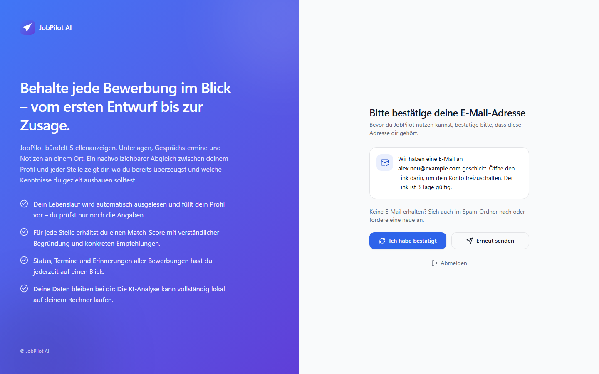

Auf dieser Seite steht, an welche Adresse die E-Mail gegangen ist und dass der Link 3 Tage gültig ist. So bestätigst du die Adresse:

1. Öffne die E-Mail und klicke auf „E-Mail-Adresse bestätigen“. Sieh bei Bedarf auch im Spam-Ordner nach.
2. Es öffnet sich die Seite „E-Mail-Adresse bestätigt“ mit der Meldung „Danke! Deine E-Mail-Adresse ist jetzt bestätigt.“. Über „Weiter zu JobPilot“ gelangst du zurück in die Anwendung.
3. Hast du den Link in einem anderen Browser oder auf einem anderen Gerät geöffnet, klickst du auf der Wartseite auf „Ich habe bestätigt“. JobPilot prüft dann den Stand und führt dich weiter. Ist die Adresse noch nicht bestätigt, erscheint „Deine E-Mail-Adresse ist noch nicht bestätigt. Öffne zuerst den Link aus der E-Mail.“

Die Seite hat drei Schaltflächen:

- **Ich habe bestätigt** prüft, ob die Bestätigung inzwischen erfolgt ist.
- **Erneut senden** verschickt eine neue E-Mail. Du siehst dann „Neue E-Mail verschickt.“. Die Schaltfläche ist danach 30 Sekunden lang gesperrt, damit nicht versehentlich mehrere E-Mails entstehen.
- **Abmelden** beendet die Sitzung, zum Beispiel um später mit einem anderen Konto weiterzumachen.

Hast du den Link schon einmal geöffnet, ist ein zweiter Klick unschädlich.

### Profil einrichten: die Willkommensseite

Nach der E-Mail-Bestätigung landest du nicht sofort im Dashboard, sondern auf der Willkommensseite („Willkommen, <Vorname>! Richte zuerst dein Profil ein.“). JobPilot vergleicht Stellen mit deinem Profil. Ohne Wunschposition und Skills sind Match-Analyse und Anschreiben kaum aussagekräftig, deshalb ist dieser Schritt verpflichtend und lässt sich nicht überspringen.

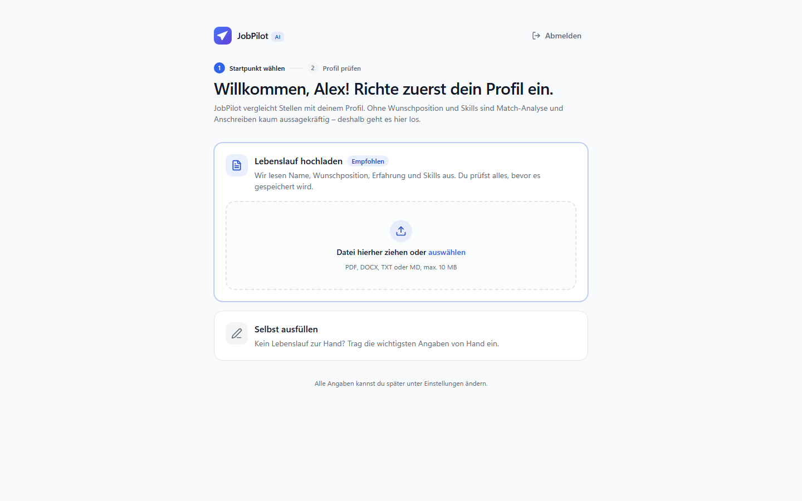

Oben zeigt eine Fortschrittsanzeige die zwei Schritte „Startpunkt wählen“ und „Profil prüfen“. Im ersten Schritt wählst du, wie du dein Profil anlegen möchtest:

- **Lebenslauf hochladen (empfohlen)**: Ziehe eine Datei (PDF, DOCX, TXT oder MD, höchstens 10 MB) auf die Fläche oder wähle sie über „auswählen“ aus. JobPilot liest Name, Wunschposition, Erfahrung und Skills aus. Mit lokaler KI kann das einige Sekunden dauern. Danach landest du direkt im zweiten Schritt, in dem die erkannten Angaben bereits eingetragen sind. Bereits ausgefüllte Felder überschreibt das Auslesen nicht. Gespeichert wird erst, wenn du den Schritt abschließt.
- **Selbst ausfüllen**: Du hast keinen Lebenslauf zur Hand? Dann gelangst du mit leeren Feldern in den zweiten Schritt und trägst die wichtigsten Angaben von Hand ein.

Im zweiten Schritt „Profil prüfen“ kontrollierst und ergänzt du die Angaben:

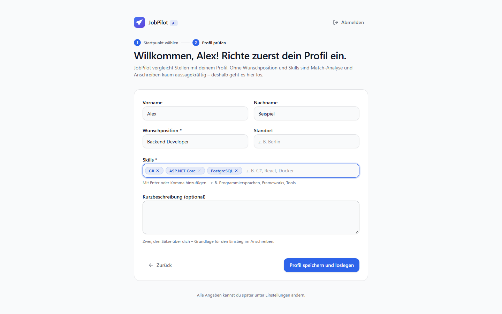

- **Vorname**, **Nachname** und **Standort**
- **Wunschposition** (Pflichtfeld, mit * markiert)
- **Skills** (Pflichtfeld, mit * markiert): mindestens ein Skill, einzeln mit Enter oder Komma hinzugefügt
- **Kurzbeschreibung** (optional): zwei, drei Sätze über dich als Grundlage für den Einstieg im Anschreiben

Fehlt die Wunschposition oder ist kein Skill eingetragen, zeigt das Formular einen Hinweis. Mit „Zurück“ kehrst du zur Auswahl des Startpunkts zurück. Klicke auf „Profil speichern und loslegen“, um den Einstieg abzuschließen. Danach öffnet sich das Dashboard.

Bis dahin führt jede Seite von JobPilot zur Willkommensseite zurück, auch nach einer erneuten Anmeldung. Angeboten wird dort nur „Abmelden“. Ob der Einstieg abgeschlossen ist, entscheidet der Server beim Speichern des Profils: Sind Wunschposition und mindestens ein Skill gespeichert, gilt er als abgeschlossen. Das bleibt auch so, wenn du später Angaben änderst oder Skills entfernst. Alle weiteren Angaben, etwa Berufserfahrung, Ausbildung oder Profilbild, ergänzt du später unter „Einstellungen“ (siehe [Profil einrichten](#2-profil-einrichten)). Konten, die vor dieser Funktion angelegt wurden, gelten als abgeschlossen und müssen den Einstieg nicht nachholen.

### Anmelden

Gib auf der Seite „Willkommen zurück“ deine E-Mail-Adresse und dein Passwort ein und klicke auf „Anmelden“. Das Kontrollkästchen „Angemeldet bleiben“ ist standardmäßig aktiviert. Nutzt du einen fremden oder gemeinsam genutzten Computer, solltest du es abwählen.

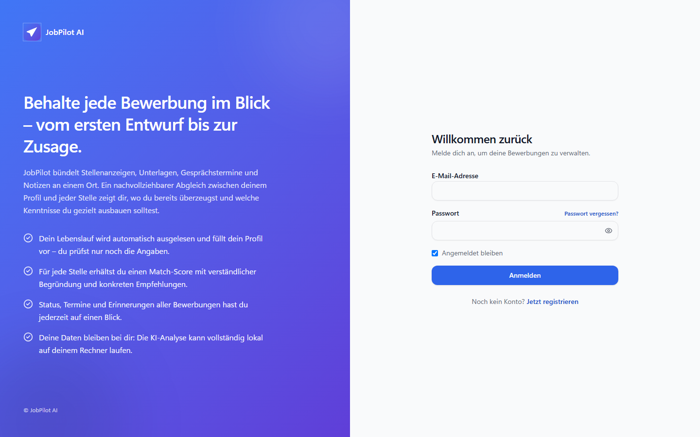

Hast du dein Passwort vergessen, klickst du neben dem Feld „Passwort“ auf „Passwort vergessen?“ (siehe nächster Abschnitt).

### Passwort vergessen

Du kommst nicht mehr in dein Konto? Dann legst du ein neues Passwort fest:

1. Klicke auf der Anmeldeseite neben dem Feld „Passwort“ auf „Passwort vergessen?“. Es erscheint die Seite „Passwort vergessen?“.
2. Gib deine E-Mail-Adresse ein und klicke auf „Link senden“.

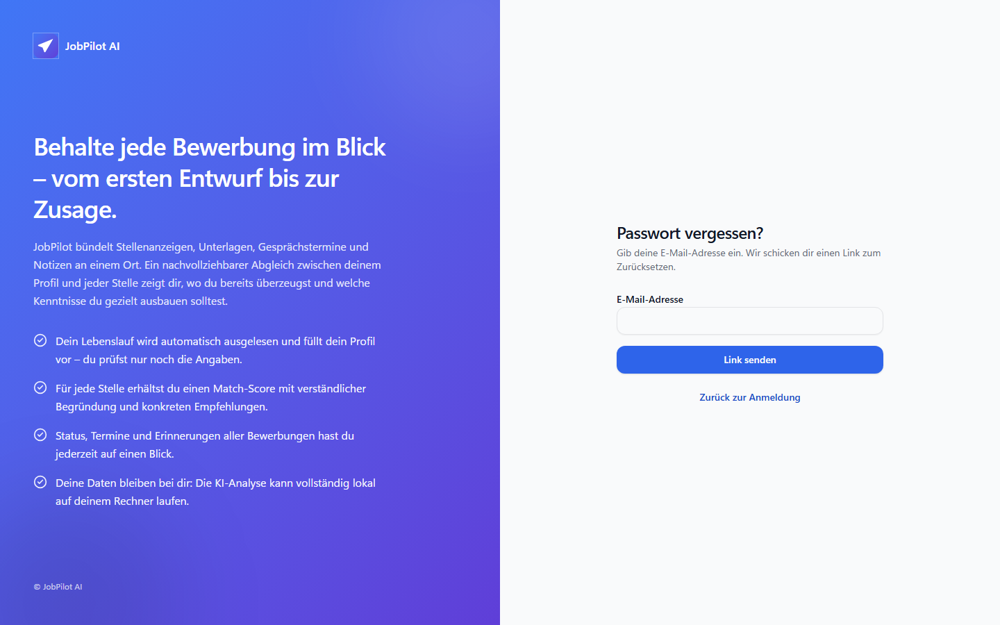

3. Du siehst die Meldung „Falls ein Konto zu dieser Adresse existiert, haben wir dir eine E-Mail mit einem Link geschickt. Der Link ist 2 Stunden gültig.“ Die Meldung ist bewusst immer gleich. So kann niemand durch Ausprobieren herausfinden, welche Adressen bei JobPilot registriert sind. Gibt es zu deiner Adresse kein Konto, bekommst du also keine E-Mail.
4. Öffne die E-Mail „Passwort zurücksetzen“ und klicke auf „Neues Passwort festlegen“.
5. Auf der Seite „Neues Passwort festlegen“ siehst du oben dein Konto. Gib bei „Neues Passwort“ und „Neues Passwort wiederholen“ dein neues Passwort ein. Die Checkliste zeigt dir live, welche Passwortregeln schon erfüllt sind. Klicke dann auf „Passwort speichern“.
6. Mit der Meldung „Dein Passwort wurde geändert. Du kannst dich jetzt anmelden.“ ist alles erledigt. Über „Zur Anmeldung“ meldest du dich mit dem neuen Passwort an.

Wichtig zum Link:

- Er ist **2 Stunden** gültig und funktioniert **nur einmal**. Nach dem Speichern ist er verbraucht.
- Ist der Link abgelaufen oder schon benutzt, erscheint „Der Link ist ungültig oder abgelaufen. Bitte fordere einen neuen an.“ Klicke dann auf „Neuen Link anfordern“.
- Eine Sperre nach mehreren Fehlversuchen wird beim Zurücksetzen aufgehoben, und deine E-Mail-Adresse gilt danach als bestätigt.
- Hast du die E-Mail nicht angefordert, ignoriere sie. Dein Passwort bleibt dann unverändert.

Das Passwort änderst du, wenn du angemeldet bist, jederzeit unter „Einstellungen“ im Bereich „Sicherheit“ (siehe [Passwort ändern](#passwort-ändern)).

### Aufbau der Oberfläche

Nach der Anmeldung siehst du links die Seitenleiste. Sie ist in drei Gruppen gegliedert:

| Gruppe | Einträge |
| --- | --- |
| Übersicht | Dashboard |
| Bewerbungen | Meine Bewerbungen, Kanban-Board, Erinnerungen |
| Werkzeuge | KI-Assistent, Dokumente, Statistiken |

Unten in der Seitenleiste findest du „Einstellungen“ und dein Benutzermenü.

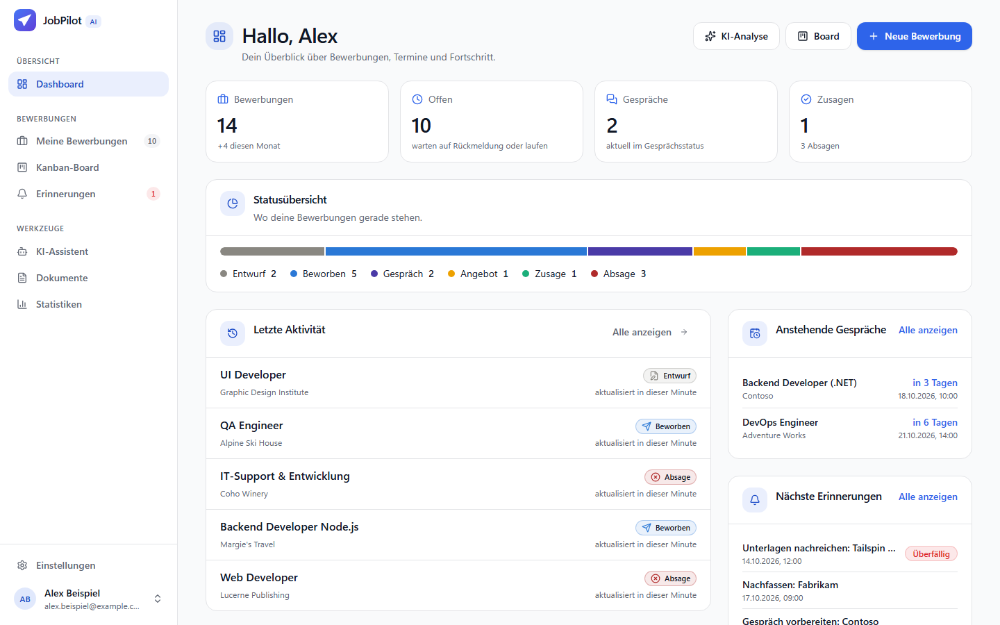

**Zähler in der Seitenleiste**

- Neben „Meine Bewerbungen“ steht die Zahl deiner offenen Bewerbungen. Als offen gelten Bewerbungen im Status „Entwurf“, „Beworben“, „Gespräch“ oder „Angebot“.
- Neben „Erinnerungen“ steht in Rot die Zahl deiner überfälligen Erinnerungen. Gibt es keine, erscheint kein Zähler.

**Benutzermenü**

Ein Klick auf deinen Namen unten links öffnet das Benutzermenü mit drei Einträgen:

- „Profil“ führt zu deinen Einstellungen.
- „Darstellung“ öffnet direkt die Darstellungseinstellungen.
- „Abmelden“ beendet deine Sitzung.

**Dashboard**

Das Dashboard begrüßt dich mit deinem Vornamen und fasst alles Wichtige zusammen:

- vier Kennzahlen: „Bewerbungen“ (mit den neuen Bewerbungen im aktuellen Monat), „Offen“, „Gespräche“ und „Zusagen“ (mit der Zahl der Absagen)
- die „Statusübersicht“, eine farbige Leiste mit der Verteilung deiner Bewerbungen. Ein Klick auf einen Status in der Legende öffnet die Bewerbungsliste mit diesem Filter.
- „Letzte Aktivität“, „Anstehende Gespräche“ und „Nächste Erinnerungen“
- oben rechts die Schaltflächen „KI-Analyse“, „Board“ und „Neue Bewerbung“

**Nutzung auf dem Smartphone**

Auf schmalen Bildschirmen ist die Seitenleiste ausgeblendet. Tippe oben links auf das Menü-Symbol (drei Striche), um sie zu öffnen. Mit dem X-Symbol oder einem Tipp neben das Menü schließt du sie wieder.

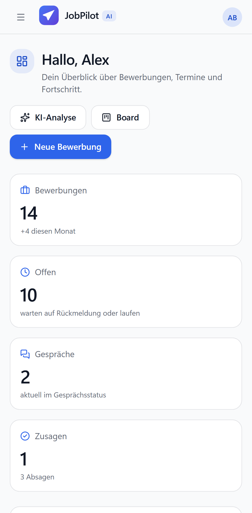

---

## 2. Profil einrichten

Je vollständiger dein Profil ist, desto besser funktionieren die Match-Analyse und das Anschreiben. JobPilot vergleicht die Anforderungen einer Stelle mit deinen Skills, deiner Erfahrung und deiner Wunschposition und verwendet deinen Namen und deine Angaben im Anschreiben.

Öffne dazu „Einstellungen“ in der Seitenleiste. Links wählst du den Bereich: „Profil“, „Lebenslauf & Skills“, „Darstellung“, „Sicherheit“ oder „Daten & Datenschutz“.

### Profil

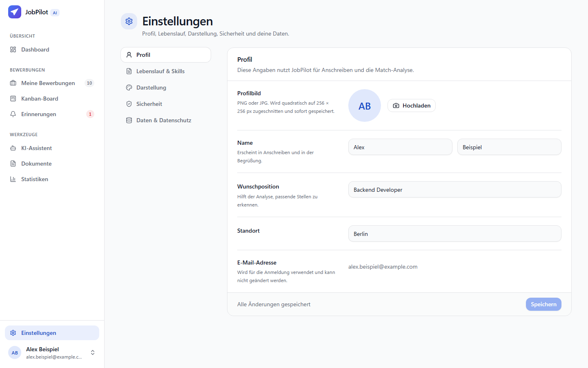

Im Bereich „Profil“ pflegst du:

- **Profilbild**: PNG oder JPG, maximal 10 MB. Das Bild wird schon in deinem Browser quadratisch auf 256 × 256 Pixel verkleinert und dann sofort gespeichert. Mit „Hochladen“ bzw. „Ändern“ wählst du eine Datei aus, mit „Entfernen“ löschst du das Bild wieder.
- **Name** (Vorname und Nachname): Er erscheint in Anschreiben und in der Begrüßung.
- **Wunschposition**, zum Beispiel „Backend Developer“. Sie hilft der Analyse, passende Stellen zu erkennen.
- **Standort**, zum Beispiel „Berlin“.
- **E-Mail-Adresse**: Sie wird für die Anmeldung verwendet und kann nicht geändert werden.

Änderungen an Name, Wunschposition und Standort werden erst übernommen, wenn du unten auf „Speichern“ klickst. Bis dahin zeigt die Fußzeile „Ungespeicherte Änderungen“. Mit „Verwerfen“ setzt du die Eingaben zurück. Wechselst du zwischen den Bereichen „Profil“ und „Lebenslauf & Skills“, bleiben deine Eingaben erhalten.

### Lebenslauf und Skills

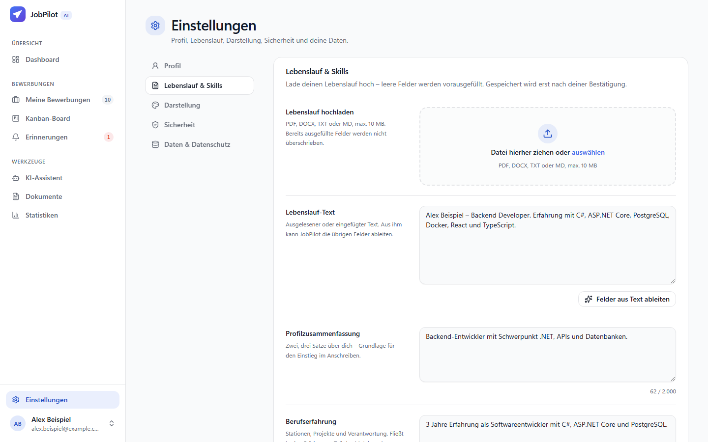

Hier erfasst du die Angaben, auf die sich die Analyse stützt:

1. **Lebenslauf hochladen**: Ziehe eine Datei auf die Fläche oder wähle sie über „auswählen“ aus. Erlaubt sind PDF, DOCX, TXT oder MD mit höchstens 10 MB.
2. JobPilot liest den Text aus und füllt Felder vor. **Bereits ausgefüllte Felder werden dabei nicht überschrieben.** Neue Skills werden zu deiner bestehenden Liste ergänzt.
3. Prüfe die Vorschläge und klicke auf „Speichern“. **Erst mit „Speichern“ werden sie übernommen.**

Weitere Felder:

- **Lebenslauf-Text**: der ausgelesene oder von dir eingefügte Text. Mit der Schaltfläche „Felder aus Text ableiten“ leitet JobPilot aus diesem Text die übrigen Felder ab. Das ist auch nützlich, wenn du den Text selbst einfügst oder änderst.
- **Profilzusammenfassung**: zwei, drei Sätze über dich. Sie sind die Grundlage für den Einstieg im Anschreiben.
- **Berufserfahrung**: Stationen, Projekte und Verantwortung. Sie fließt in den Erfahrungsanteil der Match-Analyse ein.
- **Ausbildung / Lernpfad**: Abschlüsse, Weiterbildungen und Zertifikate.
- **Skills**: Füge einzelne Skills mit Enter oder Komma hinzu, zum Beispiel „C#, React, Azure“. Der Skill-Abgleich macht 70 % des Match-Scores aus.

Die drei Textfelder Profilzusammenfassung, Berufserfahrung und Ausbildung nehmen jeweils bis zu 2.000 Zeichen auf. Ein Zähler unter dem Feld zeigt dir den Stand.

### Profil-Vollständigkeit

Solange dein Profil nicht vollständig ist, zeigt dir JobPilot oben in den Bereichen „Profil“ und „Lebenslauf & Skills“ die „Profil-Vollständigkeit“ als Prozentwert mit Fortschrittsbalken. Gewertet werden neun Angaben: Vorname, Nachname, Wunschposition, Standort, Lebenslauf-Text, Profilzusammenfassung, Berufserfahrung, Ausbildung und Skills.

Jede fehlende Angabe erscheint als kleine Schaltfläche, zum Beispiel „+ Standort“. Ein Klick darauf springt direkt zum passenden Eingabefeld. Sobald du 100 % erreicht hast, verschwindet die Anzeige.

---

## 3. Bewerbungen erfassen und verwalten

### Neue Bewerbung anlegen

Klicke auf „Neue Bewerbung“. Du findest die Schaltfläche auf dem Dashboard, in der Bewerbungsliste und im Kanban-Board.

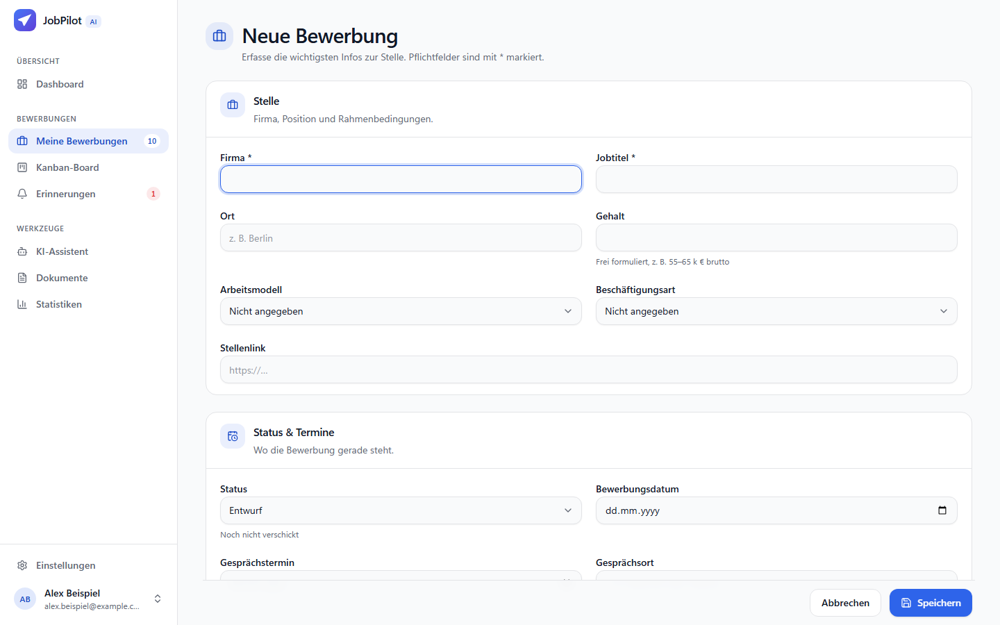

Das Formular hat vier Abschnitte. Pflichtfelder sind mit * markiert.

**Stelle**

- **Firma \*** und **Jobtitel \*** sind Pflichtfelder.
- Optional: **Ort**, **Gehalt** (frei formuliert, zum Beispiel „55–65 k € brutto“), **Arbeitsmodell** (Nicht angegeben, Vor Ort, Hybrid, Remote), **Beschäftigungsart** (Nicht angegeben, Vollzeit, Teilzeit, Befristet/Vertrag, Praktikum, Freiberuflich) und **Stellenlink** (muss mit http oder https beginnen).

**Status & Termine**

- **Status**: Entwurf, Beworben, Gespräch, Angebot, Zusage oder Absage. Unter dem Feld steht eine kurze Erklärung zum gewählten Status, zum Beispiel „Noch nicht verschickt“ beim Entwurf.
- **Bewerbungsdatum**: Ab dem Status „Beworben“ ist es ein Pflichtfeld und darf nicht in der Zukunft liegen. Beim Entwurf kannst du es leer lassen. Wechselst du vom Entwurf zu einem anderen Status, schlägt JobPilot das heutige Datum vor.
- **Gesprächstermin** und **Gesprächsort**, zum Beispiel „Videocall oder Adresse“. Steht der Status auf „Gespräch“, aber es ist kein Termin eingetragen, weist dich JobPilot darauf hin. Mit eingetragenem Termin erscheint das Gespräch auf dem Dashboard unter „Anstehende Gespräche“.

**Kontakt** (optional)

- Name, E-Mail und Telefon der Ansprechperson im Unternehmen.

**Details**

- **Technologien**: mit Enter oder Komma hinzufügen, zum Beispiel „React, C#, Docker“.
- **Stellenbeschreibung**: Sie wird für die KI-Analyse genutzt. Kopiere den Text der Anzeige am besten vollständig hinein.
- **Notizen**: eigene Anmerkungen zur Bewerbung.

Mit „Speichern“ legst du die Bewerbung an und gelangst zur Detailseite. Mit „Abbrechen“ verwirfst du das Formular. Hast du bereits etwas geändert, fragt dich JobPilot vorher, ob du die Änderungen verwerfen möchtest („Verwerfen“ oder „Weiter bearbeiten“).

Eine bestehende Bewerbung änderst du über „Bearbeiten“ (Stift-Symbol in der Liste oder Schaltfläche auf der Detailseite). Dort lautet die Überschrift „Bewerbung bearbeiten“.

### Die Bewerbungsliste

Unter „Meine Bewerbungen“ siehst du alle Bewerbungen auf einen Blick.

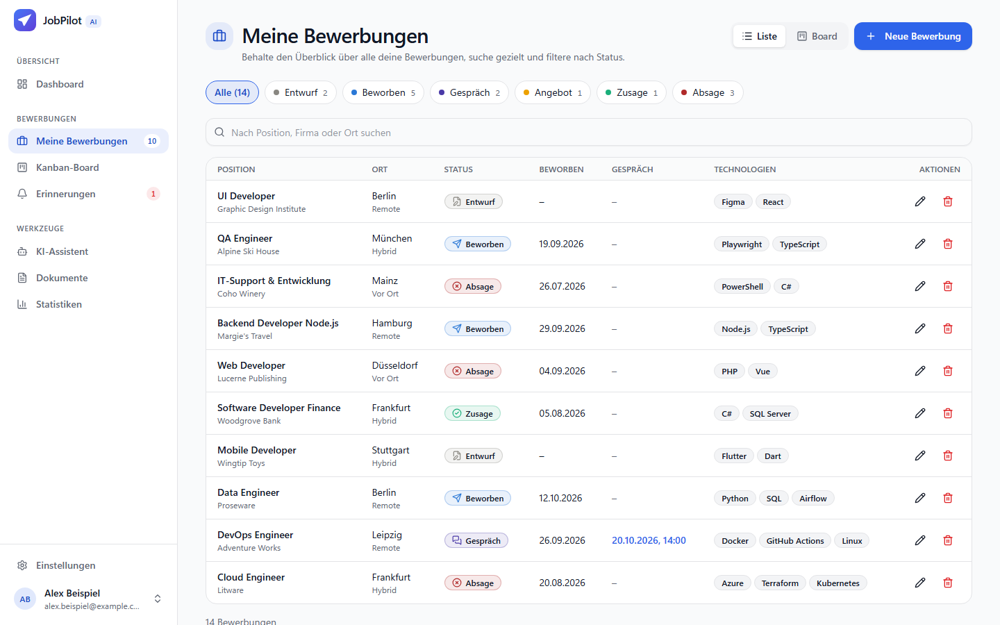

- **Statusfilter**: Über der Liste stehen Schaltflächen für „Alle“ und jeden einzelnen Status, jeweils mit der Anzahl. Ein Klick filtert die Liste.
- **Suche**: Das Suchfeld „Nach Position, Firma oder Ort suchen“ filtert, während du tippst.
- **Spalten**: Position (mit Firma), Ort (mit Arbeitsmodell), Status, Beworben, Gespräch und Technologien. Ein bevorstehender Gesprächstermin ist hervorgehoben.
- **Aktionen**: Das Stift-Symbol öffnet die Bearbeitung, das rote Papierkorb-Symbol löscht die Bewerbung nach einer Rückfrage („Bewerbung löschen?“). Das Löschen kann nicht rückgängig gemacht werden.
- Unter der Liste siehst du die Gesamtzahl und die Seitennavigation.
- Mit dem Umschalter „Liste“ und „Board“ oben rechts wechselst du zwischen Liste und Kanban-Board. Ein eingegebener Suchbegriff wird dabei mitgenommen.

Findet die Suche nichts, erscheint „Keine Treffer“ mit der Schaltfläche „Filter zurücksetzen“.

### Die Detailseite

Ein Klick auf eine Bewerbung öffnet die Detailseite.

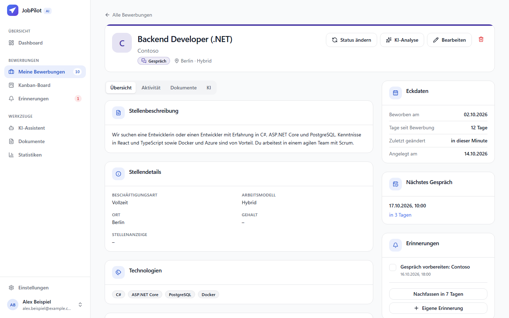

Im Kopfbereich siehst du Jobtitel, Firma, Status, Ort und Arbeitsmodell sowie einen Link zur Stellenanzeige. Rechts daneben stehen vier Aktionen:

- **Status ändern**
- **KI-Analyse**: springt zum Tab „KI“
- **Bearbeiten**
- das rote Papierkorb-Symbol zum Löschen der Bewerbung

Darunter wählst du über vier Tabs, was du sehen möchtest:

| Tab | Inhalt |
| --- | --- |
| Übersicht | Stellenbeschreibung, Stellendetails, Technologien, Kontakt und die Notiz aus dem Formular |
| Aktivität | Notizen und Verlauf der Statuswechsel |
| Dokumente | Unterlagen zu dieser Bewerbung |
| KI | Match-Analyse und Anschreiben |

In der Seitenspalte rechts findest du:

- **Eckdaten**: Beworben am, Tage seit Bewerbung, Zuletzt geändert und Angelegt am
- **Nächstes Gespräch** mit Termin und Ort (sofern eingetragen)
- **Erinnerungen** zu dieser Bewerbung

**Status ändern**

Ein Klick auf „Status ändern“ öffnet einen Dialog. Wähle den „Neuen Status“ und schreibe bei Bedarf einen „Kommentar (optional)“, zum Beispiel „Einladung per Mail von Frau Meier“. Der Kommentar erscheint im Verlauf. Mit „Speichern“ übernimmst du die Änderung. Die Schaltfläche ist erst aktiv, wenn du einen anderen Status gewählt hast.

**Notizen und Verlauf (Tab „Aktivität“)**

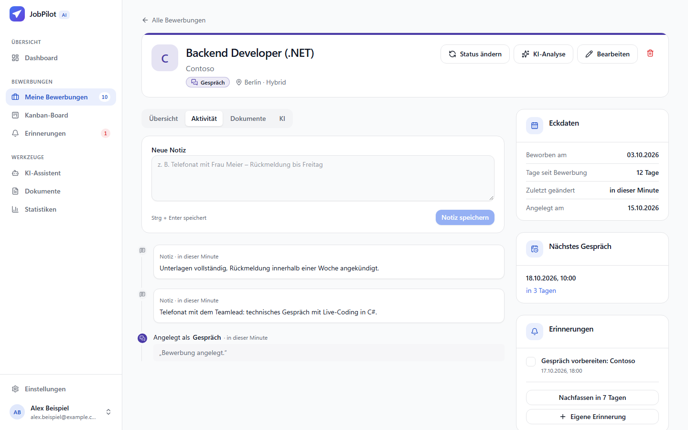

Schreibe in das Feld „Neue Notiz“, was du festhalten möchtest, zum Beispiel ein Telefonat. Speichern kannst du mit der Schaltfläche „Notiz speichern“ oder mit der Tastenkombination Strg + Enter. Eine Notiz darf bis zu 4.000 Zeichen lang sein.

Darunter zeigt eine Zeitleiste, neueste Einträge zuerst, deine Notizen und alle Statuswechsel einschließlich ihrer Kommentare. Mit dem Papierkorb-Symbol an einer Notiz löschst du sie nach einer Rückfrage.

**Erinnerungen in der Seitenspalte**

Im Kasten „Erinnerungen“ siehst du die offenen Erinnerungen dieser Bewerbung. Mit dem Kästchen links daneben markierst du eine Erinnerung als erledigt. Überfällige Erinnerungen sind rot gekennzeichnet („Überfällig“). Zwei Schaltflächen helfen beim Anlegen:

- **„Nachfassen in 7 Tagen“** legt mit einem Klick eine Erinnerung vom Typ „Nachfassen“ mit dem Titel „Nachfassen: <Firmenname>“ an. Sie wird in sieben Tagen um 9:00 Uhr fällig.
- **„Eigene Erinnerung“** öffnet den Dialog „Neue Erinnerung“ mit den Feldern Titel, Fällig am, Art und Beschreibung (optional).

---

## 4. Das Kanban-Board

Das Kanban-Board zeigt deine Bewerbungen als Karten in Spalten. Jede Spalte entspricht einem Status: Entwurf, Beworben, Gespräch, Angebot, Zusage und Absage. Du erreichst es über „Kanban-Board“ in der Seitenleiste oder über „Board“ im Umschalter der Bewerbungsliste.

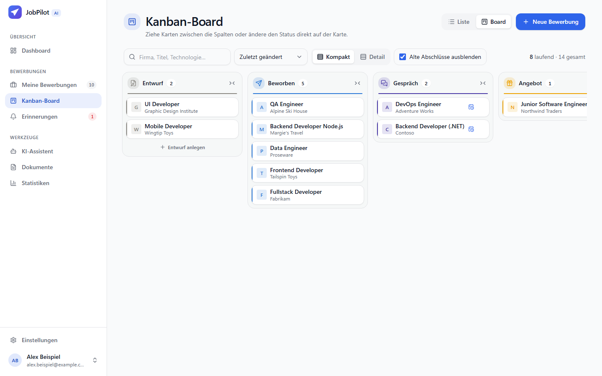

**Status ändern**

Du hast zwei Möglichkeiten:

- **Ziehen**: Greife eine Karte mit der Maus und lege sie in der gewünschten Spalte ab. Die Zielspalte zeigt dabei „Hier ablegen“.
- **Auswahl auf der Karte**: Jede Karte hat ein kleines Auswahlfeld für den Status. In der Ansicht „Kompakt“ erscheint es am Computer, sobald du mit der Maus über die Karte fährst. Auf dem Smartphone ist es immer sichtbar.

Die Karte wandert sofort in die neue Spalte. Schlägt die Änderung fehl, steht sie wieder an ihrem alten Platz und eine Fehlermeldung erscheint.

Ein Klick auf Jobtitel oder Firma einer Karte öffnet die Detailseite. Ein kleines Kalender-Symbol bzw. ein farbig hinterlegter Termin zeigt dir, dass für die Bewerbung ein Gespräch ansteht.

**Anzeige anpassen**

Über dem Board findest du diese Einstellungen:

- **Suche** „Firma, Titel, Technologie…“
- **Sortierung**: „Zuletzt geändert“, „Bewerbungsdatum“ oder „Firma A–Z“
- **Kartengröße**: „Kompakt“ zeigt Jobtitel und Firma, „Detail“ zusätzlich Ort, Arbeitsmodell, Gesprächstermin, Technologien und den Zeitpunkt der letzten Änderung.
- **Alte Abschlüsse ausblenden**: Blendet in den Spalten „Zusage“ und „Absage“ Karten aus, die seit mehr als 30 Tagen nicht geändert wurden. In der Spalte erscheint dann eine Zeile wie „5 älter als 30 Tage · einblenden“. Ein Klick darauf zeigt sie wieder an.
- Rechts daneben steht die Zahl der laufenden Bewerbungen (Beworben, Gespräch, Angebot) und die Gesamtzahl.

**Spalten einklappen**

Mit dem Symbol rechts neben dem Spaltennamen klappst du eine Spalte zu einem schmalen Streifen zusammen, der nur noch Status und Anzahl zeigt. Ein Klick auf den Streifen klappt sie wieder auf. Abgeschlossene Spalten mit mehr als 25 Karten sind zu Beginn automatisch eingeklappt.

**Viele Karten**

Jede Spalte lädt zunächst 15 Karten. Über „Weitere … laden“ am Ende der Spalte holst du die nächsten Karten. In der Spalte „Entwurf“ legst du mit „Entwurf anlegen“ direkt eine neue Bewerbung an.

Deine Board-Einstellungen (Sortierung, Kartengröße, eingeklappte Spalten, ausgeblendete Abschlüsse) werden in deinem Browser gespeichert. Sie gelten also nur auf dem Gerät, auf dem du sie eingestellt hast.

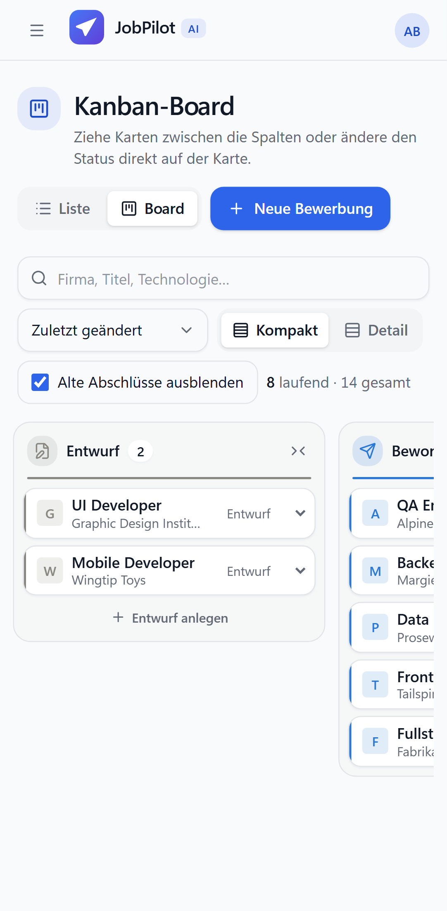

---

## 5. KI-Analyse und Anschreiben

### Was die Analyse leistet

Die Match-Analyse zeigt dir, wie gut dein Profil zu einer Stelle passt. Sie vergleicht die Stellenbeschreibung und die Technologien der Bewerbung mit deinem Profil.

### Der Match-Score

Der Match-Score ist ein Wert zwischen 0 und 100 Prozent. Er wird nach festen Regeln berechnet und setzt sich aus gewichteten Faktoren zusammen:

| Faktor | Gewicht | Was verglichen wird |
| --- | --- | --- |
| Technologien | 70 % | Wie viele der geforderten Technologien in deinem Profil oder Lebenslauf belegt sind |
| Berufserfahrung | 15 % | Gefordert sind Jahre in der Stellenbeschreibung, verglichen mit der erkannten Erfahrung aus deinem Profil |
| Wunschposition | 15 % | Überschneidung deiner Wunschposition mit dem Jobtitel |

Faktoren ohne ausreichende Daten werden nicht gewertet. Nennt die Stelle zum Beispiel keine Jahre an Berufserfahrung, fällt dieser Faktor weg.

Im KI-Assistenten ordnet ein Hinweis den Score ein: „Sehr gut passend“ (ab 80), „Gut passend“ (ab 60) oder „Verbessern möglich“ (darunter). Der Score ist eine Orientierung und keine Vorhersage deiner Chancen.

### Welche KI wird verwendet

Die Analyse läuft entweder mit einer lokal betriebenen KI oder regelbasiert:

- „Lokale KI aktiv“ mit Modellname: Eine lokal betriebene KI unterstützt die Auswertung der Stelle.
- „Regelbasierte Analyse“: Es ist keine KI eingerichtet. JobPilot wertet die Stelle nach festen Regeln aus.
- „KI nicht erreichbar – regelbasiert“: Die KI ist eingerichtet, antwortet aber gerade nicht. JobPilot arbeitet dann regelbasiert weiter.

Den Score selbst berechnet JobPilot in jedem Fall regelbasiert.

Die Empfehlungen und Lernthemen der lokalen KI bereinigt JobPilot, bevor es sie anzeigt: Floskeln und Wiederholungen entfallen, ähnliche Einträge werden zusammengefasst, und zu einem einzelnen Skill erscheinen höchstens zwei Empfehlungen. Bleiben zu wenige übrig, ergänzt JobPilot sie mit regelbasierten Empfehlungen. Das gilt auch für ältere, bereits gespeicherte Analysen.

### Analyse im KI-Assistenten

Öffne „KI-Assistent“ in der Seitenleiste.

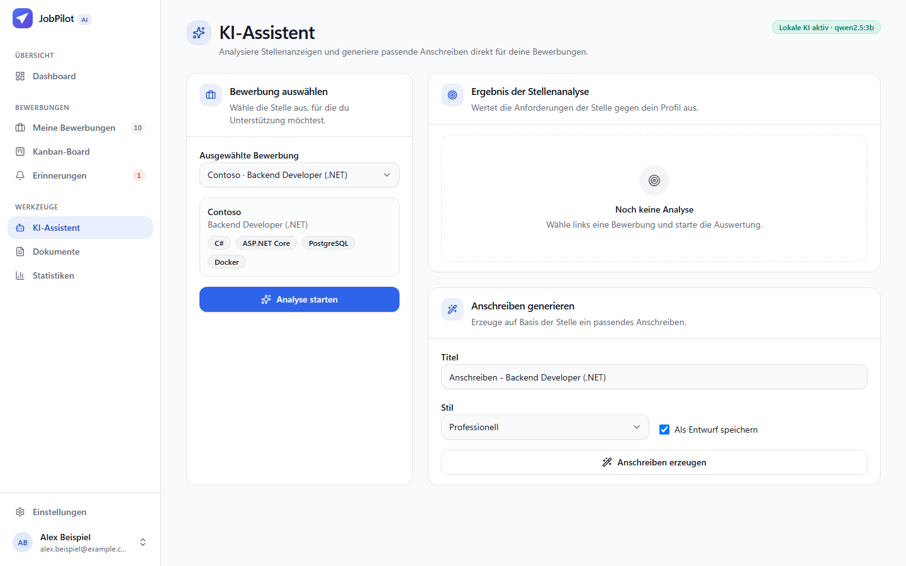

1. Wähle unter „Bewerbung auswählen“ die Stelle aus der Liste „Ausgewählte Bewerbung“.
2. Klicke auf „Analyse starten“. Mit einer lokalen KI kann die Analyse bis zu einer Minute dauern.
3. Unter „Ergebnis der Stellenanalyse“ siehst du:
   - den **Score** mit Einordnung und Zusammenfassung
   - „So setzt sich der Score zusammen“: die einzelnen Faktoren mit Gewicht und Erklärung
   - **Erforderlich**, **Abgedeckt** und **Fehlend**: Die geforderten Skills der Stelle, davon die, die dein Profil abdeckt, und die, die fehlen
   - **Empfehlungen** und **Lerninhalte**
   - einen Hinweis „So wird die Analyse genauer“ mit dem Link „Profil vervollständigen“, falls Angaben in deinem Profil fehlen

### Analyse auf der Detailseite

Auch im Tab „KI“ einer Bewerbung findest du die Analyse, ohne den Assistenten zu öffnen. Mit „Jetzt analysieren“ startest du sie, später aktualisierst du sie mit „Neu analysieren“. Der Tab zeigt den Score, die „Passenden Skills“, die „Fehlenden Skills“ und die „Empfehlungen“. Die letzte Analyse bleibt gespeichert.

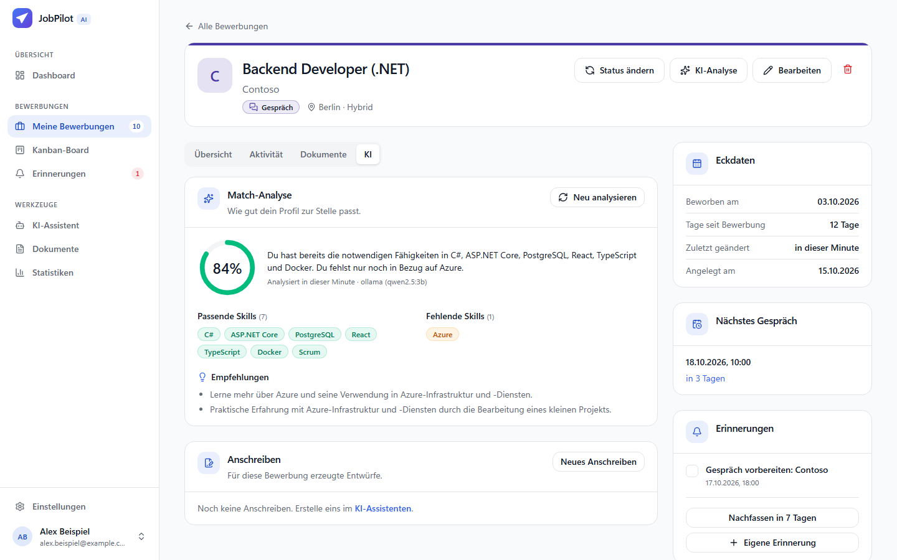

Hat die Bewerbung keine Stellenbeschreibung, weist dich JobPilot darauf hin, dass die Analyse dann ungenau ist. Über „Beschreibung ergänzen“ kommst du direkt zum Formular.

### Anschreiben erzeugen

Im KI-Assistenten findest du unter „Anschreiben generieren“ den Generator:

1. Wähle die Bewerbung (siehe oben).
2. Passe bei Bedarf den **Titel** an. Vorgeschlagen wird „Anschreiben - <Jobtitel>“.
3. Wähle den **Stil**: Professionell, Formal, Modern, Konkret oder Begeistert.
4. Lass „Als Entwurf speichern“ aktiviert, wenn du den Text noch bearbeiten willst.
5. Klicke auf „Anschreiben erzeugen“.

Das „Generierte Anschreiben“ erscheint darunter. Mit „Kopieren“ legst du es in die Zwischenablage, um es in ein Textprogramm oder deine Bewerbungsunterlagen einzufügen. Das Anschreiben ist ein Textentwurf, der aus Stelle, Technologien und deinem Profil zusammengesetzt wird. Lies ihn immer gründlich durch und ergänze persönliche Details, bevor du ihn verschickst.

### Anschreiben ansehen

Alle für eine Bewerbung erzeugten Anschreiben findest du auf der Detailseite im Tab „KI“ unter „Anschreiben“. Klicke auf den Titel, um den Text aufzuklappen. Das Symbol rechts kopiert ihn. Über „Neues Anschreiben“ öffnest du den KI-Assistenten mit bereits ausgewählter Bewerbung.

---

## 6. Erinnerungen

Mit Erinnerungen behältst du Termine, Fristen und Nachfassaktionen im Blick. Du findest sie unter „Erinnerungen“ in der Seitenleiste.

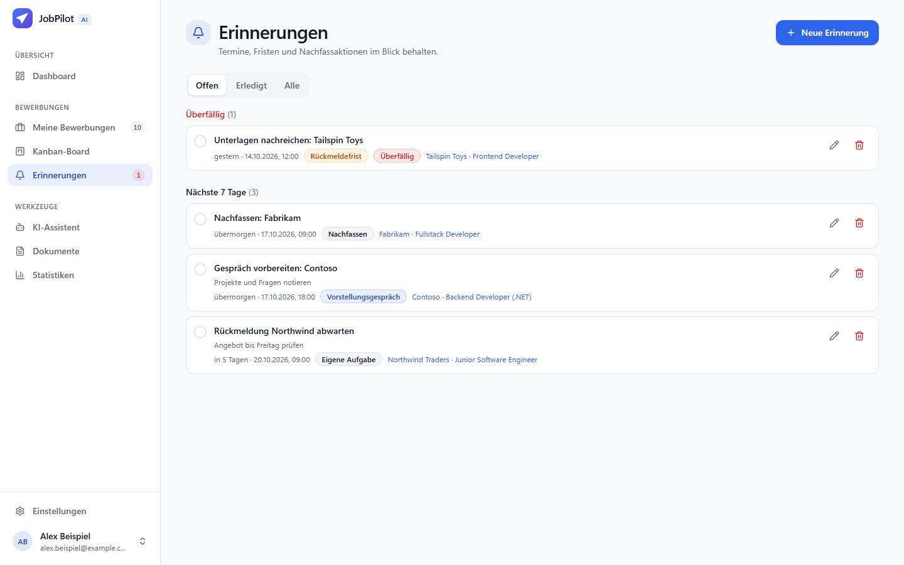

### Erinnerung anlegen

Klicke auf „Neue Erinnerung“ und fülle den Dialog aus:

- **Titel** (Pflichtfeld)
- **Beschreibung** (optional)
- **Fällig am**: Datum und Uhrzeit. Vorgeschlagen wird der nächste Tag um 9:00 Uhr.
- **Typ**: „Eigene Aufgabe“, „Vorstellungsgespräch“, „Rückmeldefrist“ oder „Nachfassen“
- **Bewerbung (optional)**: Ordne die Erinnerung einer Bewerbung zu oder wähle „Keine Zuordnung“.

Mit „Speichern“ legst du die Erinnerung an. Zu einer einzelnen Bewerbung geht es auch schneller über die Seitenspalte der Detailseite (siehe „Nachfassen in 7 Tagen“ und „Eigene Erinnerung“).

### Übersicht und Filter

Oben wählst du zwischen „Offen“, „Erledigt“ und „Alle“. Offene Erinnerungen sind nach Fälligkeit gruppiert:

- **Überfällig** (in Rot hervorgehoben)
- **Heute**
- **Nächste 7 Tage**
- **Später**

Jede Erinnerung zeigt, wann sie fällig ist, ihren Typ und, falls zugeordnet, einen Link zur Bewerbung. Eine überfällige Erinnerung trägt zusätzlich die Kennzeichnung „Überfällig“. Die Anzahl überfälliger Erinnerungen steht auch als roter Zähler in der Seitenleiste. Auf dem Dashboard zeigt „Nächste Erinnerungen“ die anstehenden Termine.

### Erledigen, bearbeiten und löschen

- Klicke auf den Kreis links neben der Erinnerung, um sie als erledigt zu markieren. In der Ansicht „Erledigt“ oder „Alle“ öffnest du sie mit demselben Kreis wieder („Wieder öffnen“).
- Das Stift-Symbol öffnet den Dialog „Erinnerung bearbeiten“.
- Das rote Papierkorb-Symbol löscht die Erinnerung nach einer Rückfrage dauerhaft.

---

## 7. Dokumente

Unter „Dokumente“ verwaltest du Lebensläufe, Anschreiben, Zeugnisse und Zertifikate an einem Ort.

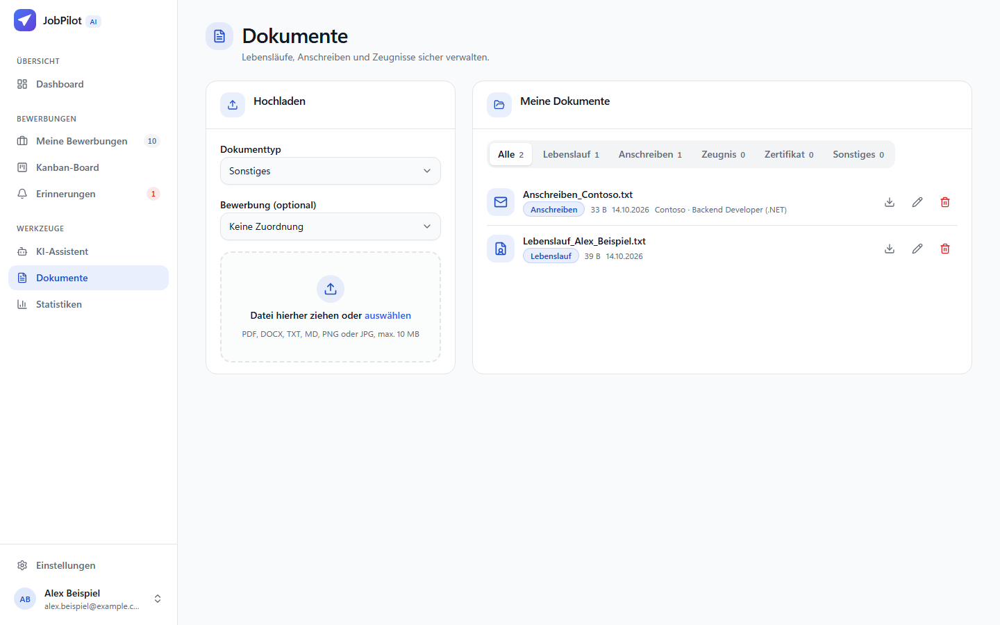

### Hochladen

1. Wähle im Bereich „Hochladen“ den **Dokumenttyp**: Lebenslauf, Anschreiben, Zeugnis, Zertifikat oder Sonstiges.
2. Ordne das Dokument bei Bedarf unter **Bewerbung (optional)** einer Bewerbung zu. Ohne Zuordnung bleibt „Keine Zuordnung“ stehen.
3. Ziehe die Datei auf die Fläche oder wähle sie mit „auswählen“ aus.

Erlaubt sind **PDF, DOCX, TXT, MD, PNG oder JPG** mit höchstens **10 MB** pro Datei. Nach dem Hochladen bestätigt dir eine Meldung, dass die Datei hochgeladen wurde.

### Verwalten

Unter „Meine Dokumente“ filterst du über die Reiter nach Dokumenttyp („Alle“, „Lebenslauf“, „Anschreiben“, „Zeugnis“, „Zertifikat“, „Sonstiges“). Die Zahl hinter dem Namen zeigt, wie viele Dokumente es je Typ gibt. Zu jedem Dokument siehst du Dateiname, Typ, Größe, Datum und die zugeordnete Bewerbung. Daneben stehen drei Symbole:

- **Herunterladen** (Pfeil nach unten): speichert die Datei auf deinem Gerät.
- **Bearbeiten** (Stift): Hier änderst du den Dokumenttyp und die Zuordnung zu einer Bewerbung.
- **Löschen** (roter Papierkorb): löscht das Dokument nach einer Rückfrage dauerhaft.

### Dokumente einer Bewerbung

Auf der Detailseite einer Bewerbung zeigt der Tab „Dokumente“ nur die Unterlagen dieser Bewerbung. Was du dort hochlädst, wird automatisch dieser Bewerbung zugeordnet. Mit dem Symbol „Zuordnung lösen“ entfernst du die Zuordnung, das Dokument bleibt aber erhalten und ist weiterhin unter „Dokumente“ zu finden.

---

## 8. Statistiken

Unter „Statistiken“ wertest du deine Bewerbungsaktivität aus. Berücksichtigt werden Bewerbungen mit einem Bewerbungsdatum. Entwürfe ohne Datum zählen nur in der Statusverteilung. Solange keine Bewerbung mit Datum erfasst ist, erscheint stattdessen ein Hinweis „Noch keine Auswertung möglich“.

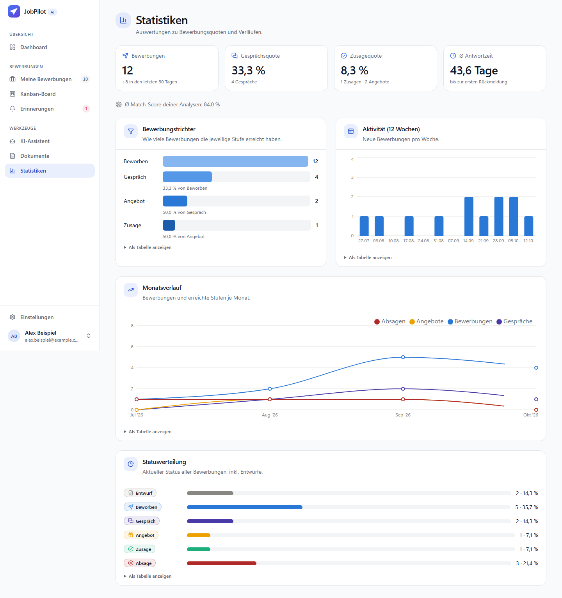

**Kennzahlen**

- **Bewerbungen**: Gesamtzahl, darunter wie viele in den letzten 30 Tagen dazugekommen sind.
- **Gesprächsquote**: Anteil der Bewerbungen, die es mindestens bis zum Gespräch geschafft haben, samt Anzahl der Gespräche. Eine Absage nach einem Gespräch zählt weiterhin als Gespräch.
- **Zusagequote**: Anteil der Bewerbungen mit Zusage, samt Anzahl der Zusagen und Angebote.
- **Ø Antwortzeit**: Durchschnittliche Zeit bis zur ersten Rückmeldung nach der Bewerbung. Ohne Rückmeldungen steht hier „–“.
- **Ø Match-Score deiner Analysen**: Durchschnitt aus deinen KI-Analysen, sobald es welche gibt.

**Diagramme**

- **Bewerbungstrichter**: Zeigt, wie viele Bewerbungen die Stufen Beworben, Gespräch, Angebot und Zusage erreicht haben. Unter jeder Stufe steht, wie viel Prozent der vorherigen Stufe das sind.
- **Aktivität (12 Wochen)**: Neue Bewerbungen pro Woche der letzten zwölf Wochen.
- **Monatsverlauf**: Bewerbungen, Gespräche, Angebote und Absagen je Monat als Linien.
- **Statusverteilung**: Aktueller Status aller Bewerbungen einschließlich Entwürfen, jeweils mit Anzahl und Anteil.

Unter jedem Diagramm kannst du über „Als Tabelle anzeigen“ die genauen Werte einsehen.

---

## 9. Darstellung anpassen

Unter „Einstellungen“ im Bereich „Darstellung“ legst du fest, wie JobPilot aussieht. Das Benutzermenü bringt dich über „Darstellung“ direkt dorthin.

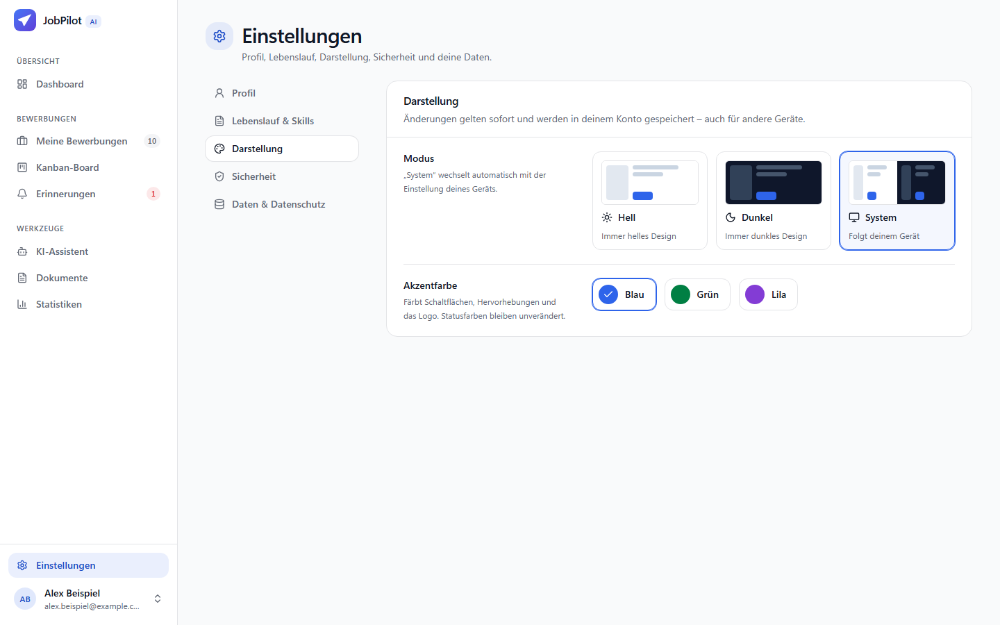

**Modus**

- „Hell“: immer helles Design
- „Dunkel“: immer dunkles Design
- „System“: folgt der Einstellung deines Geräts und wechselt automatisch mit ihr

**Akzentfarbe**

Die Akzentfarbe färbt Schaltflächen, Hervorhebungen und das Logo. Du kannst zwischen „Blau“, „Grün“ und „Lila“ wählen. Die Statusfarben (zum Beispiel Rot für „Absage“) bleiben dabei unverändert.

Änderungen gelten sofort. Sie werden in deinem Konto gespeichert und deshalb auch auf deinen anderen Geräten übernommen, sobald du dich dort anmeldest. Gelingt das Speichern im Konto einmal nicht, weist dich JobPilot darauf hin, dass die Auswahl nur auf diesem Gerät gilt.

Hier siehst du das Dashboard im dunklen Modus:

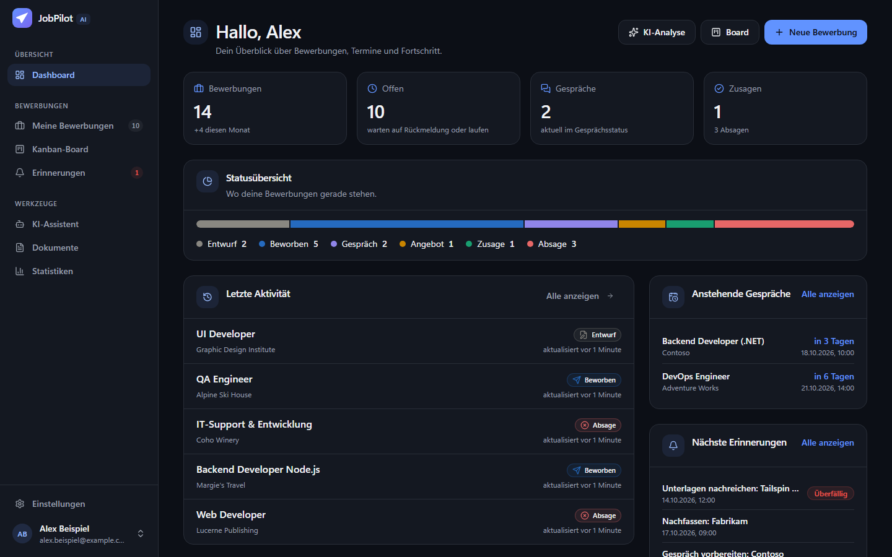

Und mit den Akzentfarben Lila und Grün:

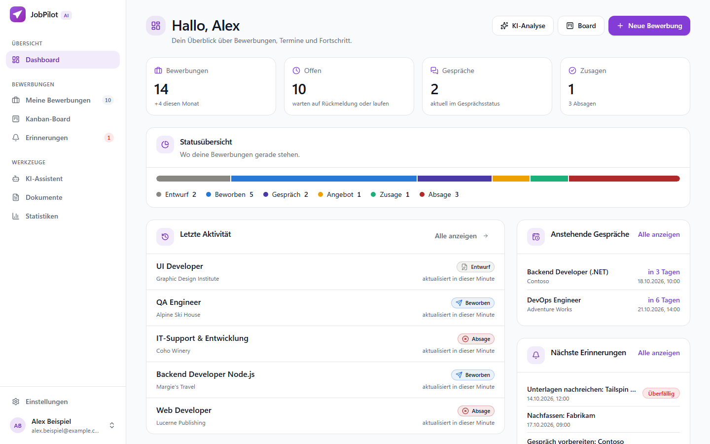

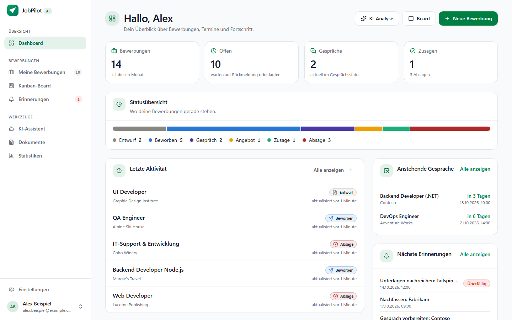

Auch die Detailseite einer Bewerbung passt sich an:

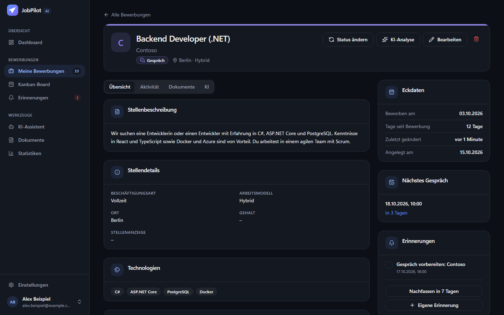

---

## 10. Daten und Datenschutz

### Passwort ändern

Im Bereich „Sicherheit“ der Einstellungen änderst du dein Passwort. Gib dein „Aktuelles Passwort“ und zweimal das „Neue Passwort“ ein. Eine Checkliste zeigt dir live, welche Regeln schon erfüllt sind (mindestens 10 Zeichen, ein Großbuchstabe, ein Kleinbuchstabe, eine Ziffer, beide Eingaben stimmen überein). Mit „Passwörter anzeigen“ blendest du die Eingaben ein, mit „Passwort ändern“ speicherst du das neue Passwort. Das neue Passwort muss sich vom bisherigen unterscheiden.

### Deine Daten herunterladen

Im Bereich „Daten & Datenschutz“ kannst du jederzeit eine Kopie aller Daten anfordern, die JobPilot zu deinem Konto speichert.

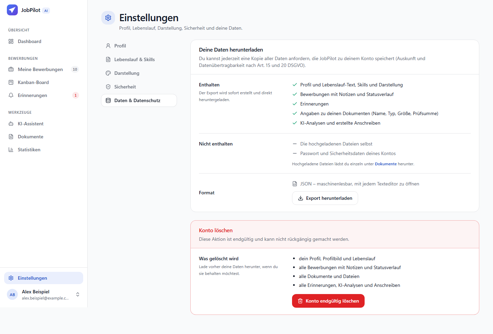

Klicke auf „Export herunterladen“. Der Export wird sofort erstellt und als JSON-Datei heruntergeladen. Dieses Format ist maschinenlesbar und lässt sich mit jedem Texteditor öffnen.

**Enthalten sind:**

- Profil und Lebenslauf-Text, Skills und Darstellung
- Bewerbungen mit Notizen und Statusverlauf
- Erinnerungen
- Angaben zu deinen Dokumenten (Name, Typ, Größe, Prüfsumme)
- KI-Analysen und erstellte Anschreiben

**Nicht enthalten sind:**

- die hochgeladenen Dateien selbst. Diese lädst du einzeln unter „Dokumente“ herunter.
- Passwort und Sicherheitsdaten deines Kontos

### Konto löschen

Mit „Konto endgültig löschen“ entfernst du dein Konto samt aller Daten. **Das ist endgültig und kann nicht rückgängig gemacht werden.** Gelöscht werden:

- dein Profil, Profilbild und Lebenslauf
- alle Bewerbungen mit Notizen und Statusverlauf
- alle Dokumente und Dateien
- alle Erinnerungen, KI-Analysen und Anschreiben

Lade deshalb vorher deine Daten und die Dateien herunter, wenn du sie behalten möchtest. Zur Sicherheit musst du die Löschung im Dialog „Konto endgültig löschen?“ mit deinem aktuellen Passwort bestätigen und dann auf „Endgültig löschen“ klicken. Anschließend landest du wieder auf der Anmeldeseite.

---

## 11. Häufige Fragen

**Warum ist das Bewerbungsdatum Pflicht?**
Ab dem Status „Beworben“ braucht JobPilot das Datum, um Kennzahlen wie die Antwortzeit und die Auswertungen in den Statistiken berechnen zu können. Nur im Status „Entwurf“ darfst du es leer lassen. Das Datum darf außerdem nicht in der Zukunft liegen.

**Was passiert, wenn die KI nicht verfügbar ist?**
Dann arbeitet JobPilot regelbasiert weiter. Oben im KI-Assistenten steht in diesem Fall „KI nicht erreichbar – regelbasiert“. Du bekommst weiterhin Score, passende und fehlende Skills und Empfehlungen, sie werden dann aber ohne KI nach festen Regeln ermittelt.

**Wie wird der Match-Score berechnet?**
Nach festen Regeln: Technologien zählen 70 %, Berufserfahrung 15 % und die Wunschposition 15 %. Faktoren ohne ausreichende Daten werden nicht gewertet. Je vollständiger dein Profil und je genauer die Stellenbeschreibung, desto aussagekräftiger ist der Score.

**Warum finde ich auf dem Board weniger Karten als in der Liste?**
Wahrscheinlich ist „Alte Abschlüsse ausblenden“ aktiviert. Dann fehlen in den Spalten „Zusage“ und „Absage“ Karten, die länger als 30 Tage unverändert sind. Ein Klick auf die Zeile „… älter als 30 Tage · einblenden“ zeigt sie wieder an. Prüfe außerdem, ob eine Spalte eingeklappt ist oder ob du über „Weitere … laden“ noch weitere Karten nachladen kannst.

**Werden meine Dateien beim Export mitgeliefert?**
Nein. Der Export enthält nur Angaben zu deinen Dokumenten (Name, Typ, Größe, Prüfsumme), nicht die Dateien selbst. Diese lädst du einzeln unter „Dokumente“ mit dem Symbol „Herunterladen“ herunter.

**Mein hochgeladener Lebenslauf hat meine Angaben nicht ersetzt. Ist das ein Fehler?**
Nein, das ist so gewollt. Beim Auslesen eines Lebenslaufs füllt JobPilot nur leere Felder aus und ergänzt Skills. Bereits ausgefüllte Felder bleiben unverändert. Außerdem werden die Vorschläge erst mit „Speichern“ übernommen. Möchtest du ein Feld neu befüllen lassen, leere es vorher.

**Warum lande ich nach der Registrierung oder Anmeldung auf der Willkommensseite?**
Dein Profil ist noch nicht eingerichtet. Solange Wunschposition und mindestens ein Skill fehlen, führt jede Seite zur Willkommensseite zurück. Trage beides ein und klicke auf „Profil speichern und loslegen“, danach steht dir die ganze Anwendung offen.

**Kann ich die Willkommensseite überspringen?**
Nein. Die einzige Alternative dort ist „Abmelden“. Ein einmal abgeschlossener Einstieg bleibt abgeschlossen, auch wenn du später Skills oder die Wunschposition wieder entfernst.

**Ich habe keine E-Mail von JobPilot bekommen. Was kann ich tun?**
Sieh zuerst im Spam-Ordner nach und prüfe, ob du die Adresse richtig geschrieben hast. Eine Bestätigungsmail kannst du dir auf der Seite „Bitte bestätige deine E-Mail-Adresse“ über „Erneut senden“ noch einmal schicken lassen; nach dem Klick ist die Schaltfläche 30 Sekunden gesperrt. Hast du die Adresse auf einem anderen Gerät bestätigt, klicke hier auf „Ich habe bestätigt“. Den Link zum Zurücksetzen des Passworts forderst du auf der Seite „Passwort vergessen?“ neu an. Zu einer Adresse ohne Konto verschickt JobPilot bewusst keine E-Mail, auch wenn die Seite dieselbe Meldung zeigt.

**Mein Link aus der E-Mail funktioniert nicht mehr. Was nun?**
Links zum Zurücksetzen des Passworts gelten 2 Stunden und nur einmal, Bestätigungslinks 3 Tage. Fordere einen neuen Link an: über „Passwort vergessen?“ auf der Anmeldeseite bzw. über „Erneut senden“ auf der Seite „Bitte bestätige deine E-Mail-Adresse“. Nutze immer die neueste E-Mail und kopiere den Link vollständig, falls du ihn nicht anklickst.

**Muss ich meine E-Mail-Adresse bestätigen, um JobPilot zu nutzen?**
Ja, die Bestätigung ist Pflicht. Du kannst dich zwar auch ohne Bestätigung anmelden, siehst dann aber nur die Seite „Bitte bestätige deine E-Mail-Adresse“, und der Server sperrt alle Funktionen, bis die Adresse bestätigt ist. Nur das Abmelden, das erneute Senden der E-Mail, der Datenexport und das Löschen des Kontos sind vorher möglich. Konten, die schon vor dieser Regel angelegt wurden, gelten als bestätigt.

**Kann ich meine E-Mail-Adresse ändern?**
Nein. Die E-Mail-Adresse wird für die Anmeldung verwendet und lässt sich nicht ändern.

**Sind meine Einstellungen auf jedem Gerät gleich?**
Modus und Akzentfarbe ja, sie werden in deinem Konto gespeichert. Die Einstellungen des Kanban-Boards (Sortierung, Kartengröße, eingeklappte Spalten, ausgeblendete Abschlüsse) gelten dagegen nur in dem Browser, in dem du sie vorgenommen hast.
